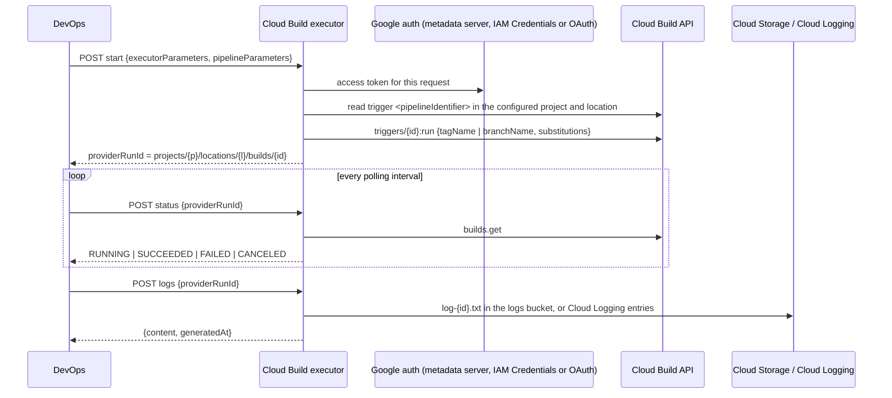

# Cloud Build executor

A DevOps executor for **Google Cloud Build**. DevOps (`odm-platform-pp-devops-server`) uses it to run a data product's pipeline as one task of an activity: the executor runs an existing Cloud Build trigger at the version's branch or tag, reports the build status, returns the build log and cancels a running build.

It implements the DevOps executor API v2 with the same contract as the GitLab executor (`odm-platform-adapter-devops-executor-gitlab`). It is a stateless Quarkus service (Java 21) that talks to Google over plain HTTPS, without Google client libraries.

- [How it works](#how-it-works)
- [Endpoints](#endpoints)
- [Which trigger runs](#which-trigger-runs)
- [Authentication: two modes](#authentication-two-modes)
- [Deployment on GCP (workload identity)](#deployment-on-gcp-workload-identity)
- [Deployment outside GCP (service-account key)](#deployment-outside-gcp-service-account-key)
- [Cloud Build setup](#cloud-build-setup)
- [Substitutions](#substitutions)
- [Status mapping](#status-mapping)
- [Logs](#logs)
- [Configuration](#configuration)
- [DevOps and agent configuration](#devops-and-agent-configuration)
- [Build and run](#build-and-run)
- [Statelessness](#statelessness)
- [Limits and open points](#limits-and-open-points)

## How it works



## Endpoints

All four calls are `POST` under `/api/v2/up/executor/tasks/`, and every body carries `executorParameters`. OpenAPI is served at `/api-docs`, Swagger UI at `/swagger-ui`.

| Path | Request body | Response |
| --- | --- | --- |
| `/start` | `{ "executorParameters", "pipelineParameters" }` | `{ "providerRunId" }`: the build resource name |
| `/status` | `{ "executorParameters", "providerRunId" }` | `{ "providerRunId", "status" }` |
| `/logs` | `{ "executorParameters", "providerRunId" }` | `{ "content", "generatedAt" }` |
| `/cancel` | `{ "executorParameters", "providerRunId" }` | empty **200** |

Errors are answered with the status below and a plain-text message, which DevOps shows to the user. Messages never contain tokens or keys.

| Status | When |
| --- | --- |
| **400** | Missing `executorParameters`, `pipelineIdentifier`, `ref.name` or `ref.type`. A malformed `providerRunId`, or one outside the configured project and location. In service-account-key mode, a missing or invalid key header. Invalid substitutions (see [Substitutions](#substitutions)). Cloud Build rejected the run. |
| **404** | No trigger with that name in the configured project and location, or an unknown build. |
| **409** | Cancel of a build that has already ended. Cloud Build is not called. |
| **502** | Google refused the credentials (the message quotes Google's reason, which usually names the missing permission), Google failed, or the metadata server is not reachable. |

### `executorParameters`

| Field | Use |
| --- | --- |
| `pipelineIdentifier` | **Required.** The name of the Cloud Build trigger to run. |
| `ref.name` | **Required.** The branch or tag to build. For a release, DevOps sends the version's tag. |
| `ref.type` | **Required.** `BRANCH` or `TAG`: the trigger runs with `branchName` or `tagName`. |
| `dataProductRepo`, `repositoryKey` | Ignored: the trigger already binds the repository. |

## Which trigger runs

- The **descriptor task** names the trigger in `pipelineIdentifier`, with its name as shown in the Cloud Build console (for example `dp-release`).
- The **executor configuration** holds the GCP project and the Cloud Build location (`executor.cloudbuild.project`, `executor.cloudbuild.location`). One executor deployment serves one project and location. To run triggers of another project, deploy another executor and declare it under its own name in DevOps and in the agent.
- The executor reads the trigger by name. If Cloud Build does not resolve the name, it lists the location's triggers and matches the name. It then runs the trigger by its id.
- On status, logs and cancel the executor checks that the `providerRunId` belongs to the configured project and location, and answers 400 otherwise. Let running tasks finish before changing `project` or `location`.

## Authentication: two modes

The mode is set once, in the executor configuration (`executor.cloudbuild.auth.mode`). A token is obtained for each request and dropped when the request ends. Nothing is cached.

| | `workload-identity` | `service-account-key` |
| --- | --- | --- |
| Where it runs | On GCP: Cloud Run, or GKE with Workload Identity | Anywhere |
| Credential | The executor's own service account, from the metadata server. Optionally exchanged for another service account's token (`auth.impersonate-service-account`) | A service-account JSON key, sent by DevOps in header `x-odm-gcp-service-account-key` on every call |
| Who Cloud Build sees | The executor's (or the impersonated) service account, for every run | The service account whose key the user stored as a personal secret |
| Secrets in Blindata | None | One personal secret per user, type `gcp-service-account-key` |
| Run length cap | DevOps polling cap only | DevOps `secrets-ttl`: after it, DevOps stops sending the key |

In workload-identity mode the executor ignores any secret header. In service-account-key mode:

- The key header name is `x-odm-<auth.key-secret-type>`; the default type is `gcp-service-account-key`. The type must be lowercase letters and digits separated by hyphens, and must not contain `executor-secret`: the agent and DevOps lowercase secret types and split the header on `-executor-secret-`.
- The value is the JSON key encoded in base64 on one line (raw JSON is accepted too). A key is about 3 KB.
- The executor signs a JWT (RS256) with the key and exchanges it at `https://oauth2.googleapis.com/token` for a token with the `cloud-platform` scope. It sends the assertion only to the configured token endpoint, never to the `token_uri` written in the key.
- A malformed key is a 400 that names the header and never quotes the value.

How the key travels, for a user who picked their personal secret in the Blindata UI:

| Hop | Header | What happens |
| --- | --- | --- |
| UI → Blindata agent | `x-odm-ag-cloudbuild-executor-secret-gcp-service-account-key: <secret name>` | The UI sends the name of the personal secret, never its value. |
| Agent → DevOps | `x-odm-cloudbuild-executor-secret-gcp-service-account-key: <key>` | The agent resolves the personal secret by name and type and puts its value in the header. |
| Inside DevOps | in memory, for `secrets-ttl` | DevOps keeps the executor's secret headers for the activity, renamed to `x-odm-<secretType>`. |
| DevOps → executor | `x-odm-gcp-service-account-key: <key>` | Sent on every start, status, logs and cancel call. |

## Deployment on GCP (workload identity)

This is the recommended setup when the executor can run in a GCP project, and the one used by the PoC demo environment.

1. **Create the executor's service account**, for example `odm-cloudbuild-executor@<project>.iam.gserviceaccount.com`.
2. **Grant it the Cloud Build roles** on the triggers' project (see [IAM roles](#iam-roles)). To keep those roles on a separate account, grant them to that account instead, give the executor's account `roles/iam.serviceAccountTokenCreator` on it, and set `auth.impersonate-service-account` to its email.
3. **Deploy the executor** with that service account. On Cloud Run:

   ```bash
   gcloud run deploy odm-cloudbuild-executor \
     --image=<registry>/odm-platform-adapter-devops-executor-cloudbuild:<version> \
     --service-account=odm-cloudbuild-executor@<project>.iam.gserviceaccount.com \
     --port=9080 --no-allow-unauthenticated --region=<region> \
     --set-env-vars=CLOUDBUILD_PROJECT=<project>,CLOUDBUILD_LOCATION=<location>,CLOUDBUILD_AUTH_MODE=workload-identity
   ```

   On GKE, bind the Kubernetes service account of the pod to the GCP service account (Workload Identity) and set the same environment variables.
4. **Let DevOps reach the executor** on port 9080 (internal ingress, VPC connector or private network). The executor has no authentication of its own: expose it only to DevOps.
5. **Declare the executor in DevOps and in the agent** without secrets (see [DevOps and agent configuration](#devops-and-agent-configuration)).

If the metadata server is not reachable, every call fails with 502 and a message saying that workload-identity mode needs the executor to run on GCP.

## Deployment outside GCP (service-account key)

Use this mode when the executor runs outside GCP (on premises, another cloud, a Blindata-hosted environment).

1. **Create a service account** for the builds that DevOps starts, and grant it the Cloud Build roles on the triggers' project (see [IAM roles](#iam-roles)).
2. **Create a JSON key** for it. Organisations created on or after 3 May 2024 block key creation by default (`iam.disableServiceAccountKeyCreation`): an organisation administrator must allow it for that project.
3. **Encode the key on one line**: `base64 -w0 key.json`.
4. **Store it in Blindata** as a personal secret of type `gcp-service-account-key`, for each user who runs activities, and delete the local key file.
5. **Deploy the executor** with `CLOUDBUILD_AUTH_MODE=service-account-key`, `CLOUDBUILD_PROJECT` and `CLOUDBUILD_LOCATION`. The image is the same.
6. **Declare the executor in DevOps and in the agent**, with the secret type in the agent (see [DevOps and agent configuration](#devops-and-agent-configuration)), and set the DevOps `secrets-ttl` above the longest build.

The key travels in an HTTP header on the agent → DevOps → executor path. DevOps (Spring Boot) accepts 8 KB of headers per request by default; a key takes about 3 KB of that.

### IAM roles

Grant these to the principal that calls Cloud Build: the executor's service account, the impersonated one, or the one whose key is used.

| Role | On | Why |
| --- | --- | --- |
| `roles/cloudbuild.builds.editor` | the triggers' project | Read triggers, run them (`cloudbuild.builds.create`), read builds, cancel (`cloudbuild.builds.update`) |
| `roles/iam.serviceAccountUser` | the service account the trigger runs builds as | Running a trigger acts as that account (`iam.serviceAccounts.actAs`) |
| `roles/storage.objectViewer` | the builds' logs bucket | Read `log-<id>.txt`. Add `roles/logging.viewAccessor` for a user-owned bucket |
| `roles/logging.viewer` | the triggers' project | Read the build's entries in Cloud Logging |

Without the log roles the executor still runs and reports builds; the log block says which role is missing.

## Cloud Build setup

- Connect the data product repository to Cloud Build (repository connections, 2nd generation: GitHub, GitLab, Bitbucket).
- Create one trigger per pipeline, in the location of the executor configuration. Its name is what descriptors put in `pipelineIdentifier`.
- Declare in the trigger every substitution the pipeline expects, with a default value (for example `_ENV=lab`). Only declared substitutions are sent.
- The trigger's build config (`cloudbuild.yaml`) and service account are owned by the project's team: the executor never creates or edits triggers.

## Substitutions

Pipeline parameters reach the build only as substitutions:

- A parameter name becomes `_` + the name in upper case, with every character outside `A-Z`, `0-9` and `_` replaced by `_`: `env` → `_ENV`, `data-set` → `_DATA_SET`. A name that already starts with `_` keeps one.
- Only keys the trigger declares are sent. The others are dropped, and their names (never their values) go to the executor's log. A declared key with no parameter keeps the trigger's default.
- Two parameters that become the same key (`env` and `ENV`) are a 400.
- Cloud Build limits apply before any call: at most 200 substitutions, keys up to 100 bytes, values up to 4000 bytes. Anything larger is a 400.

## Status mapping

| Cloud Build | DevOps |
| --- | --- |
| `PENDING`, `QUEUED`, `WORKING`, `STATUS_UNKNOWN`, any new value | `RUNNING` |
| `SUCCESS` | `SUCCEEDED` |
| `FAILURE`, `INTERNAL_ERROR`, `TIMEOUT`, `EXPIRED` | `FAILED` |
| `CANCELLED` | `CANCELED`, whoever canceled the build (DevOps, the console or `gcloud`) |

A build waiting in a queue stays `RUNNING` until Cloud Build expires it (`queueTtl`) or the DevOps poll cap ends the task.

## Logs

The executor reads the build, then its log from the first place that holds it:

| Build `options.logging` | Read from |
| --- | --- |
| `LEGACY` or unset, with a logs bucket | `log-<id>.txt` in the logs bucket, then Cloud Logging |
| `LEGACY` or unset, without a bucket | Cloud Logging |
| `GCS_ONLY` | the logs bucket |
| `CLOUD_LOGGING_ONLY` | Cloud Logging (entries of `resource.type="build"` with the build id, oldest first) |
| `NONE` | nothing: the block says the build stores no logs |

The block is cut at `logs.max-size` (default 5 MB) and marked as truncated. When no source can be read, the block lists why for each source, naming the role to grant when Google refused access. Builds that run as a user-specified service account cannot write to the Google-owned default bucket: give those triggers a logs bucket or `CLOUD_LOGGING_ONLY`.

## Configuration

`executor.cloudbuild.*` in `application.yaml`, or the environment variables shown. The service refuses to start on a missing or invalid value, naming the key.

| Key | Default | Meaning |
| --- | --- | --- |
| `project` (`CLOUDBUILD_PROJECT`) | none, required | GCP project of the triggers |
| `location` (`CLOUDBUILD_LOCATION`) | none, required | `global`, or the triggers' region (for example `europe-west8`) |
| `auth.mode` (`CLOUDBUILD_AUTH_MODE`) | none, required | `workload-identity` or `service-account-key` |
| `auth.impersonate-service-account` (`CLOUDBUILD_IMPERSONATE_SERVICE_ACCOUNT`) | none | Workload-identity mode only: email of the service account to act as |
| `auth.key-secret-type` | `gcp-service-account-key` | Service-account-key mode: the key arrives in `x-odm-<key-secret-type>` |
| `http.connect-timeout` | `5s` | Connection timeout of every Google call |
| `http.request-timeout` | `30s` | Timeout of token, metadata and log-object calls (the Cloud Build and Cloud Logging JSON calls use the template client's 60 s) |
| `http.read-retries` | `2` | Retries of idempotent calls on 429, 5xx or a network error; the trigger run and the cancel are never retried |
| `http.retry-backoff` | `500ms` | Pause between retries |
| `logs.max-size` | `5M` | Bound of the log block |
| `logs.cloud-logging-page-size` | `1000` | Entries per Cloud Logging page |
| `endpoints.cloud-build`, `endpoints.logging`, `endpoints.storage`, `endpoints.oauth-token`, `endpoints.iam-credentials`, `endpoints.metadata` | Google's public endpoints | Overridden only by tests, or for private service endpoints |

The HTTP port is 9080.

## DevOps and agent configuration

DevOps server (`odm-platform-pp-devops-server`):

```yaml
odm:
  utility-plane:
    executors:
      polling-interval: 30s
      secrets-ttl: 4h               # service-account-key mode: must exceed the longest build
      services:
        cloudbuild:
          address: http://odm-platform-adapter-devops-executor-cloudbuild:9080
          execution-mode: full-control
```

Blindata agent, DevOps proxy configuration (`servicesConfigurations.devops.executors`):

```yaml
cloudbuild:
  specification: CloudBuild
  specificationVersion: 1.0.0
  secrets:                          # service-account-key mode only; omit in workload-identity mode
    - secretType: gcp-service-account-key
```

The executor name (`cloudbuild` here) is chosen by the administrator and must be the same in DevOps, in the agent and in the descriptor tasks. In the descriptor, each task that uses this executor sets `pipelineIdentifier` to the trigger's name.

## Build and run

Requirements: Java 21 and the included Maven wrapper (`sh ./mvnw` if it is not executable).

```bash
./mvnw verify                       # unit tests (*Test) and integration tests (*IT) against a local Google stub
```

```bash
CLOUDBUILD_PROJECT=<project> CLOUDBUILD_LOCATION=<location> CLOUDBUILD_AUTH_MODE=service-account-key ./mvnw quarkus:dev
```

The container image runs the native executable on port 9080:

```bash
./mvnw package -DskipTests -Dnative -Dquarkus.native.container-build=true
docker build -t odm-platform-adapter-devops-executor-cloudbuild .
```

The design and implementation notes are in `spdd/analysis/` and `spdd/prompt/` (story BDMD-5810).

## Statelessness

The executor keeps no run, no credential and no token between requests: the provider run id carries the build's project and location, DevOps sends the key on every call (key mode), and the metadata server gives a token on demand (identity mode). Run as many replicas as needed. A start that times out after Cloud Build accepted it leaves a build running; the executor never retries a run, so it never starts a build twice.

## Limits and open points

These Cloud Build behaviours are not stated in Google's reference and are to be confirmed against a real 2nd-generation trigger:

- whether `triggers.get` resolves a trigger by name (the executor falls back to listing the triggers);
- whether `triggers:run` accepts a branch or tag for 2nd-generation (repository connection) triggers;
- whether substitutions passed to `triggers:run` are merged with the trigger's defaults or replace them;
- the shape of the operation returned by `triggers:run` (the executor reads `metadata.build.id`, then `metadata.build.name`);
- the Cloud Logging filter for a build's entries.

Other limits: child builds started by a build are not followed; the native build has not been run yet for this service.
