# Cloud Build executor

A DevOps executor for **Google Cloud Build**. The Open Data Mesh DevOps server (`odm-platform-pp-devops-server`) uses it to run a data product's pipeline on Cloud Build. DevOps asks it to start a task, polls the task's status, reads its log and can cancel it. The executor turns each of these requests into calls to the Cloud Build API.

It implements the DevOps executor API v2, with the same contract as the GitLab executor (`odm-platform-adapter-devops-executor-gitlab`). It is a stateless Quarkus service (Java 21) that talks to Google over plain HTTPS, without Google client libraries.

**Contents**

- [What the executor does](#what-the-executor-does)
  - [Where it sits](#where-it-sits)
  - [The life of a task](#the-life-of-a-task)
  - [What it does not do](#what-it-does-not-do)
- [Supported features](#supported-features)
  - [Run a trigger at a branch or tag](#run-a-trigger-at-a-branch-or-tag)
  - [Pipeline parameters as substitutions](#pipeline-parameters-as-substitutions)
  - [Build status](#build-status)
  - [Build log](#build-log)
  - [Cancel](#cancel)
  - [Errors](#errors)
  - [Statelessness and scaling](#statelessness-and-scaling)
- [Installation](#installation)
  - [Prerequisites](#prerequisites)
  - [Step 1: prepare Cloud Build](#step-1-prepare-cloud-build)
  - [Step 2: create the service account and grant the IAM roles](#step-2-create-the-service-account-and-grant-the-iam-roles)
  - [Step 3: deploy the executor](#step-3-deploy-the-executor)
  - [Step 4: declare the executor in DevOps and in the agent](#step-4-declare-the-executor-in-devops-and-in-the-agent)
  - [Step 5: name the trigger in the descriptor](#step-5-name-the-trigger-in-the-descriptor)
  - [Configuration reference](#configuration-reference)
  - [Build from source](#build-from-source)
- [Authentication](#authentication)
  - [Choose a mode](#choose-a-mode)
  - [Workload identity](#workload-identity)
  - [Service-account key](#service-account-key)
  - [How the key reaches the executor](#how-the-key-reaches-the-executor)
- [API reference](#api-reference)
- [Limits and open points](#limits-and-open-points)

## What the executor does

A data product version declares, in its descriptor, the tasks of its lifecycle activities. Each task names an executor and the pipeline to run. When a user runs an activity from the Blindata UI, DevOps sends each task to the executor the task names.

This executor maps a task onto Cloud Build:

| DevOps task | Cloud Build |
| --- | --- |
| The pipeline (`executorParameters.pipelineIdentifier`) | A **trigger**, by its name |
| The version to build (`executorParameters.ref`) | The **branch or tag** the trigger runs at |
| The pipeline parameters | The trigger's **substitutions** (`env` becomes `_ENV`) |
| The provider run id | The **build** the run started (`projects/P/locations/L/builds/ID`) |
| The task status | The build status |
| The task log | The build log |

### Where it sits

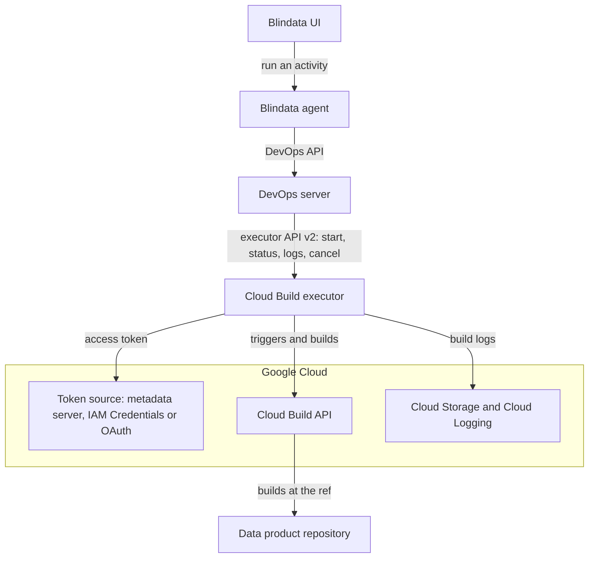

The executor is the only component that talks to Google. DevOps, the agent and the UI only know the executor API.

### The life of a task

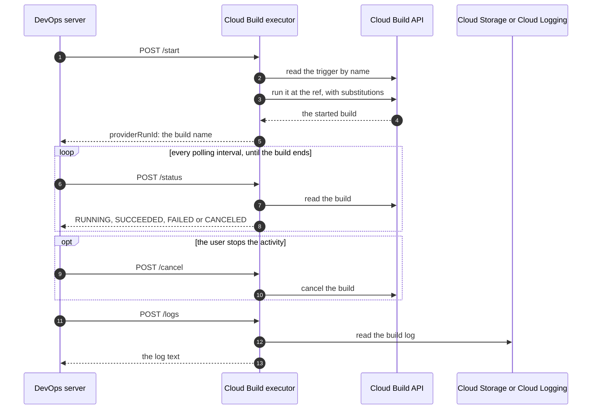

Every request first obtains its own access token from Google (see [Authentication](#authentication)).

### What it does not do

- It does not create, edit or delete triggers, and it does not know the build steps. The trigger, its `cloudbuild.yaml` and its service account belong to the project's team.
- It keeps no state between requests: no database, no table of runs, no token cache.
- It does not follow child builds that a build starts.
- It has no authentication of its own: expose it only to DevOps.
- One deployment serves one GCP project and one Cloud Build location. For another project or location, deploy another executor and declare it under its own name.

## Supported features

| Feature | Endpoint | In short |
| --- | --- | --- |
| [Run a trigger at a branch or tag](#run-a-trigger-at-a-branch-or-tag) | `start` | The trigger is named in the task; project and location come from the executor configuration |
| [Pipeline parameters as substitutions](#pipeline-parameters-as-substitutions) | `start` | `env` becomes `_ENV`; only keys the trigger declares are sent |
| [Build status](#build-status) | `status` | Cloud Build statuses mapped to the four DevOps statuses |
| [Build log](#build-log) | `logs` | From the logs bucket or Cloud Logging, up to 5 MB |
| [Cancel](#cancel) | `cancel` | Only a running build |
| [Two authentication modes](#authentication) | all | Workload identity on GCP, or a service-account key sent by DevOps |
| [Errors DevOps can show](#errors) | all | 400, 404, 409 or 502 with a plain-text message |
| [Statelessness](#statelessness-and-scaling) | all | Any number of replicas |

### Run a trigger at a branch or tag

The task names the trigger in `executorParameters.pipelineIdentifier`, with the name shown in the Cloud Build console (for example `dp-release`). The executor looks for it in the project and location of its own configuration, and runs it at the task's ref.

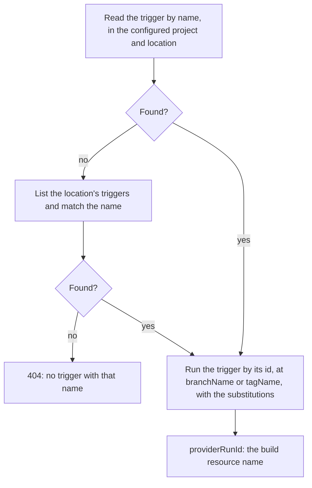

- The task must carry `pipelineIdentifier`, `ref.name` and `ref.type`, else it is a 400 and nothing runs.
- `ref.type` `BRANCH` runs the trigger with `branchName`, `TAG` with `tagName`. For a release, DevOps sends the version's tag.
- `dataProductRepo` and `repositoryKey` are ignored: the trigger already binds the repository.
- If Cloud Build refuses the run, the task fails with 400 and Google's message.
- The run is never retried, so a start never creates two builds.

### Pipeline parameters as substitutions

Pipeline parameters reach the build only as substitutions. In this example the trigger declares `_ENV` and `_DATA_SET`:

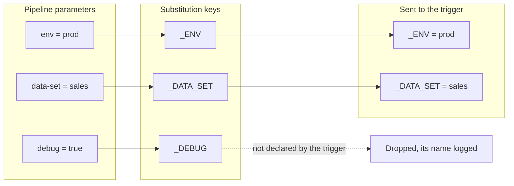

- **Key**: `_` plus the parameter name in upper case, with every character outside `A-Z`, `0-9` and `_` replaced by `_`. `env` becomes `_ENV`, `data-set` becomes `_DATA_SET`. A name that already starts with `_` keeps one.
- **Declared keys only**: the trigger must declare every substitution the pipeline uses. Other parameters are dropped, and only their names (never their values) go to the executor's log. A declared key without a parameter keeps the trigger's default.
- **Collisions**: two parameters that become the same declared key (`env` and `ENV`) are a 400. Parameters that are dropped never block the start.
- **Limits**: Cloud Build's limits are checked before any call: at most 200 substitutions, keys up to 100 bytes, values up to 4000 bytes. A larger one, or a null value, is a 400.

### Build status

The task's status follows the build's. The diagram shows the DevOps statuses, and on each arrow the Cloud Build statuses that lead there:

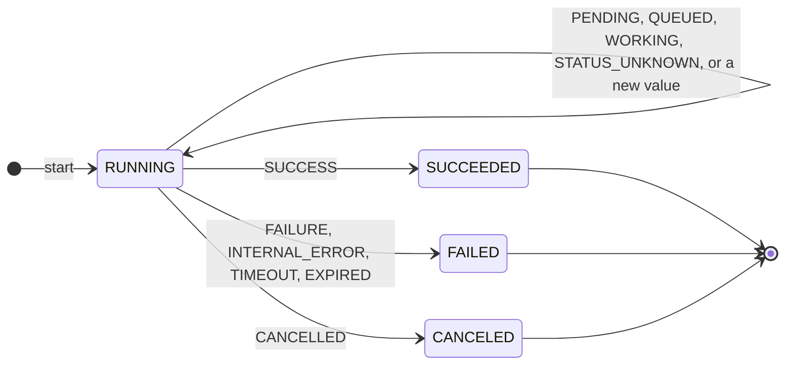

- A status Google adds in the future is read as `RUNNING`, so the task keeps polling instead of failing.
- `CANCELED` is reported whoever canceled the build: DevOps, the Cloud Build console or `gcloud`.
- A build waiting in a queue stays `RUNNING` until Cloud Build expires it (`queueTtl`) or the DevOps polling cap ends the task.

### Build log

The executor reads the build, then takes its log from the first source that holds it:

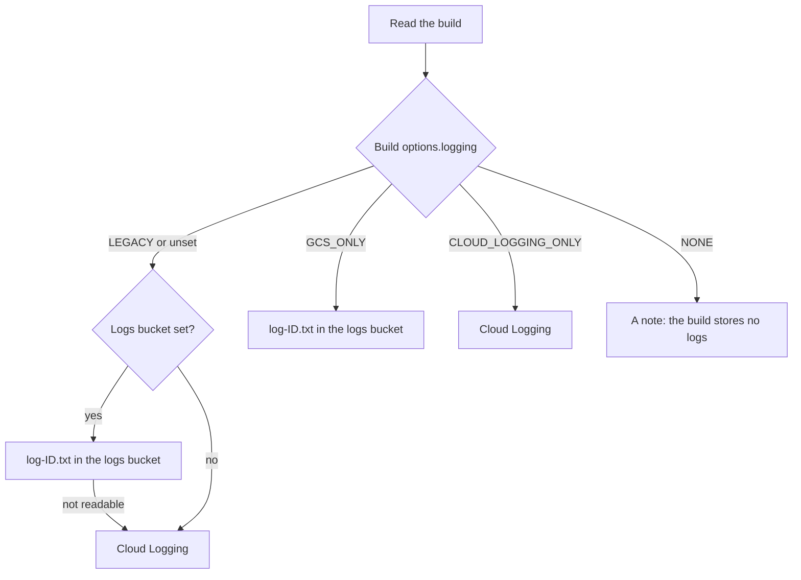

- Cloud Logging entries are those of `resource.type="build"` with the build's id, oldest first.
- The log is cut at `logs.max-size` (default 5 MB) and marked as truncated.
- When no source can be read, the log text says why for each source, and names the role to grant when Google refused access. Status and cancel keep working without log permissions.
- Builds that run as a user-specified service account cannot write to the Google-owned default bucket: give those triggers a logs bucket, or `CLOUD_LOGGING_ONLY`.

### Cancel

The executor reads the build first. An unknown build is a 404. A build that has already ended is a 409, and Cloud Build is not called. A running build is canceled, and its next status is `CANCELED`.

### Errors

Errors are answered with a status and a plain-text message, which DevOps shows to the user. Messages never contain tokens or keys.

| Status | When |
| --- | --- |
| **400** | Missing `executorParameters`, `pipelineIdentifier`, `ref.name` or `ref.type`. A malformed `providerRunId`, or one outside the configured project and location. In service-account-key mode, a missing or invalid key header. Invalid substitutions. Cloud Build refused the run. |
| **404** | No trigger with that name in the configured project and location, or an unknown build. |
| **409** | Cancel of a build that has already ended. |
| **502** | Google refused the credentials (the message quotes Google's reason, which usually names the missing permission), Google failed or did not answer, or the metadata server is not reachable. |

### Statelessness and scaling

The executor keeps no run, no credential and no token between requests:

- The provider run id carries the build's project and location. On status, logs and cancel the executor checks that it belongs to the configured project and location, and answers 400 otherwise. Let running tasks finish before you change `project` or `location`.
- In service-account-key mode DevOps sends the key on every call. In workload-identity mode the metadata server gives a token on demand.

Run as many replicas as you need. Read calls are retried on 429, 5xx and network errors (`http.read-retries`). The trigger run and the cancel are never retried: a start that times out after Cloud Build accepted it leaves one build running, never two.

## Installation

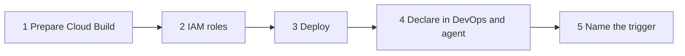

Steps 2 and 3 depend on the [authentication mode](#choose-a-mode): `workload-identity` when the executor runs on GCP, `service-account-key` when it runs anywhere else.

### Prerequisites

- A GCP project with the Cloud Build API enabled, and the IAM Service Account Credentials API enabled if you use impersonation.
- The DevOps server with the executor API v2, and the Blindata agent.
- The container image. Each GitHub release publishes it as `ghcr.io/opendatamesh-initiative/odm-platform-adapter-devops-executor-cloudbuild:<version>` and `opendatamesh/odm-platform-adapter-devops-executor-cloudbuild:<version>` on Docker Hub. Before a release, [build it from source](#build-from-source).

### Step 1: prepare Cloud Build

- Connect the data product repository to Cloud Build (repository connections, 2nd generation: GitHub, GitLab or Bitbucket).
- Create one trigger per pipeline, in the location the executor will use. Its name is what descriptors put in `pipelineIdentifier`.
- Declare in the trigger every substitution the pipeline expects, with a default value (for example `_ENV=lab`). Only declared substitutions are sent.
- The trigger's build config (`cloudbuild.yaml`) and the service account it runs builds as are owned by the project's team. The executor only runs the trigger.

### Step 2: create the service account and grant the IAM roles

Create the service account that will call Cloud Build:

- **Workload identity**: the executor's own service account, for example `odm-cloudbuild-executor@<project>.iam.gserviceaccount.com`. To keep the Cloud Build roles on a separate account, grant them to that account instead, give the executor's account `roles/iam.serviceAccountTokenCreator` on it, and set `auth.impersonate-service-account` to its email.
- **Service-account key**: a service account for the builds DevOps starts, with a JSON key. Organisations created on or after 3 May 2024 block key creation by default (`iam.disableServiceAccountKeyCreation`): an organisation administrator must allow it for that project.

Grant it these roles:

| Role | On | Why |
| --- | --- | --- |
| `roles/cloudbuild.builds.editor` | the triggers' project | Read triggers, run them (`cloudbuild.builds.create`), read builds, cancel them (`cloudbuild.builds.update`) |
| `roles/iam.serviceAccountUser` | the service account the trigger runs builds as | Running a trigger acts as that account (`iam.serviceAccounts.actAs`) |
| `roles/storage.objectViewer` | the builds' logs bucket | Read `log-<id>.txt`. Add `roles/logging.viewAccessor` for a user-owned bucket |
| `roles/logging.viewer` | the triggers' project | Read the build's entries in Cloud Logging |

Without the two log roles the executor still runs builds and reports their status; the log text says which role is missing.

### Step 3: deploy the executor

The image is the same in both modes; `CLOUDBUILD_AUTH_MODE` selects the mode. The HTTP port is 9080. The service refuses to start on a missing or invalid setting, naming the key.

#### On GCP, with workload identity

On Cloud Run:

```bash
gcloud run deploy odm-cloudbuild-executor \
  --image=<registry>/odm-platform-adapter-devops-executor-cloudbuild:<version> \
  --service-account=odm-cloudbuild-executor@<project>.iam.gserviceaccount.com \
  --port=9080 --no-allow-unauthenticated --region=<region> \
  --set-env-vars=CLOUDBUILD_PROJECT=<project>,CLOUDBUILD_LOCATION=<location>,CLOUDBUILD_AUTH_MODE=workload-identity
```

Add `CLOUDBUILD_IMPERSONATE_SERVICE_ACCOUNT=<email>` to impersonate another account.

On GKE, bind the pod's Kubernetes service account to the GCP service account (Workload Identity) and set the same environment variables.

Let DevOps reach the executor on port 9080 (internal ingress, VPC connector or private network). If the metadata server is not reachable, every call fails with 502 and a message saying that workload-identity mode needs the executor to run on GCP.

#### Outside GCP, with a service-account key

1. Deploy the image with `CLOUDBUILD_AUTH_MODE=service-account-key`, `CLOUDBUILD_PROJECT` and `CLOUDBUILD_LOCATION`, for example with Docker:

   ```bash
   docker run -d -p 9080:9080 \
     -e CLOUDBUILD_PROJECT=<project> -e CLOUDBUILD_LOCATION=<location> \
     -e CLOUDBUILD_AUTH_MODE=service-account-key \
     opendatamesh/odm-platform-adapter-devops-executor-cloudbuild:<version>
   ```

2. Encode the key on one line: `base64 -w0 key.json`.
3. Each user who runs activities stores it in Blindata as a personal secret of type `gcp-service-account-key`. Then delete the local key file.
4. Set the DevOps `secrets-ttl` above the longest build: after it, DevOps stops sending the key.

The key travels in an HTTP header on the agent → DevOps → executor path. DevOps (Spring Boot) accepts 8 KB of headers per request by default; a key takes about 3 KB of that.

### Step 4: declare the executor in DevOps and in the agent

DevOps server (`odm-platform-pp-devops-server`):

```yaml
odm:
  utility-plane:
    executors:
      polling-interval: 30s
      secrets-ttl: 4h               # service-account-key mode: must exceed the longest build
      services:
        cloudbuild:
          address: http://odm-platform-adapter-devops-executor-cloudbuild:9080
          execution-mode: full-control
```

Blindata agent, DevOps proxy configuration (`servicesConfigurations.devops.executors`):

```yaml
cloudbuild:
  specification: CloudBuild
  specificationVersion: 1.0.0
  secrets:                          # service-account-key mode only; omit in workload-identity mode
    - secretType: gcp-service-account-key
```

The executor name (`cloudbuild` here) is chosen by the administrator. It must be the same in DevOps, in the agent and in the descriptor tasks.

### Step 5: name the trigger in the descriptor

In the data product descriptor, each task that uses this executor names it (`cloudbuild` above) and sets `pipelineIdentifier` to the trigger's name. DevOps adds the ref of the version being built.

### Configuration reference

`executor.cloudbuild.*` in `application.yaml`, or the environment variables shown.

| Key | Default | Meaning |
| --- | --- | --- |
| `project` (`CLOUDBUILD_PROJECT`) | none, required | GCP project of the triggers |
| `location` (`CLOUDBUILD_LOCATION`) | none, required | `global`, or the triggers' region (for example `europe-west8`) |
| `auth.mode` (`CLOUDBUILD_AUTH_MODE`) | none, required | `workload-identity` or `service-account-key` |
| `auth.impersonate-service-account` (`CLOUDBUILD_IMPERSONATE_SERVICE_ACCOUNT`) | none | Workload-identity mode only: email of the service account to act as |
| `auth.key-secret-type` | `gcp-service-account-key` | Service-account-key mode: the key arrives in `x-odm-<key-secret-type>` |
| `http.connect-timeout` | `5s` | Connection timeout of every Google call |
| `http.request-timeout` | `30s` | Timeout of token, metadata and log-object calls (the Cloud Build and Cloud Logging JSON calls use the template client's 60 s) |
| `http.read-retries` | `2` | Retries of idempotent calls on 429, 5xx or a network error; the trigger run and the cancel are never retried |
| `http.retry-backoff` | `500ms` | Pause between retries |
| `logs.max-size` | `5M` | Bound of the log text |
| `logs.cloud-logging-page-size` | `1000` | Entries per Cloud Logging page |
| `endpoints.cloud-build`, `endpoints.logging`, `endpoints.storage`, `endpoints.oauth-token`, `endpoints.iam-credentials`, `endpoints.metadata` | Google's public endpoints | Overridden only by tests, or for private service endpoints |

### Build from source

Requirements: Java 21 and the included Maven wrapper (`sh ./mvnw` if it is not executable).

```bash
./mvnw verify                       # unit tests (*Test) and integration tests (*IT) against a local Google stub
```

```bash
CLOUDBUILD_PROJECT=<project> CLOUDBUILD_LOCATION=<location> CLOUDBUILD_AUTH_MODE=service-account-key ./mvnw quarkus:dev
```

The container image runs the native executable on port 9080:

```bash
./mvnw package -DskipTests -Dnative -Dquarkus.native.container-build=true
docker build -t odm-platform-adapter-devops-executor-cloudbuild .
```

The design and implementation notes are in `spdd/analysis/` and `spdd/prompt/` (story BDMD-5810).

## Authentication

The executor needs a Google access token for every call it makes. The mode is set once, in the executor configuration (`executor.cloudbuild.auth.mode`). A token is obtained for each request and dropped when the request ends: nothing is cached, and tokens and keys never appear in logs or error messages.

### Choose a mode

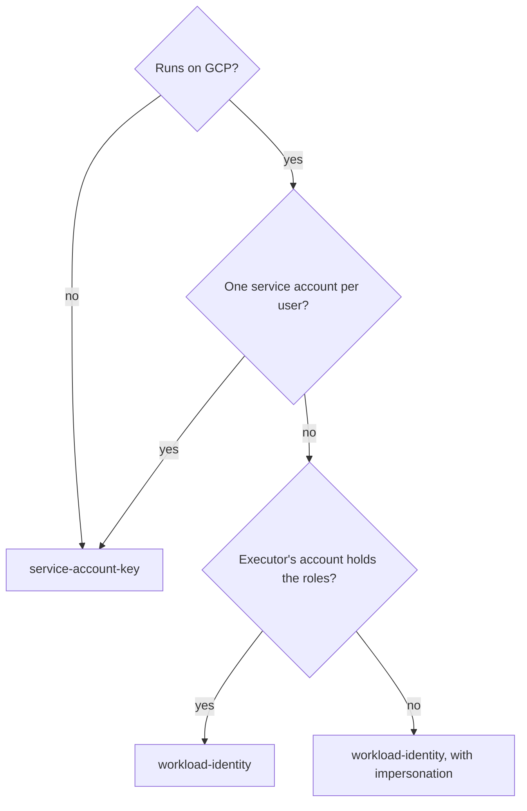

1. **Runs on GCP?** Workload identity needs the GCP metadata server: Cloud Run, or GKE with Workload Identity.
2. **One service account per user?** In workload-identity mode Cloud Build sees the same service account for every run. If each user must act under their own service account, use keys.
3. **Executor's account holds the roles?** If the Cloud Build roles must stay on another service account, the executor impersonates it (`auth.impersonate-service-account`).

| | `workload-identity` | `service-account-key` |
| --- | --- | --- |
| Where it runs | On GCP: Cloud Run, or GKE with Workload Identity | Anywhere |
| Credential | The executor's own service account, from the metadata server, optionally exchanged for another account's token | A service-account JSON key, sent by DevOps in header `x-odm-gcp-service-account-key` on every call |
| Who Cloud Build sees | The executor's (or the impersonated) service account, for every run | The service account whose key the user stored as a personal secret |
| Secrets in Blindata | None | One personal secret per user, type `gcp-service-account-key` |
| Longest run | DevOps polling cap | DevOps `secrets-ttl`: after it, DevOps stops sending the key |
| Recommended when | The executor can run in a GCP project | The executor runs outside GCP |

### Workload identity

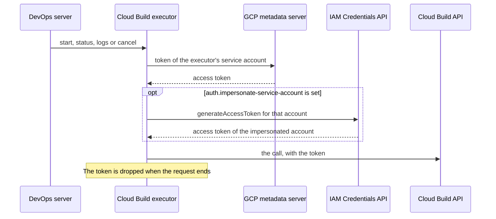

- The executor asks the metadata server (`http://metadata.google.internal`) for its service account's token.
- With `auth.impersonate-service-account`, it exchanges that token through the IAM Credentials API (`generateAccessToken`) for a token of the named account, with the `cloud-platform` scope and a one-hour lifetime. The executor's account needs `roles/iam.serviceAccountTokenCreator` on it.
- Secret headers from DevOps are ignored, so the agent needs no secret for this executor.
- Outside GCP the metadata server is not reachable: every call fails with 502.

### Service-account key

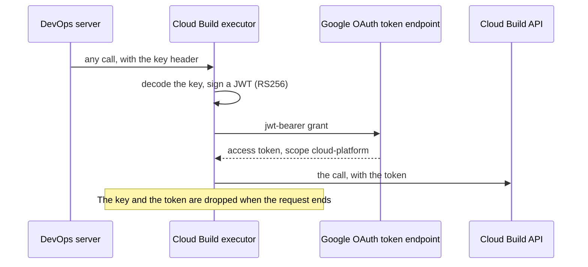

- **Header**: `x-odm-<auth.key-secret-type>`, by default `x-odm-gcp-service-account-key`. A missing header is a 400 that names it.
- **Value**: the JSON key encoded in base64 on one line (raw JSON is accepted too). A malformed key is a 400 that names the header and never quotes the value.
- **Exchange**: the executor signs a JWT with the key (issuer the key's `client_email`, audience the token endpoint, scope `cloud-platform`, valid for one hour) and exchanges it at `https://oauth2.googleapis.com/token` (`endpoints.oauth-token`). It sends the JWT only to that configured endpoint, never to the `token_uri` written in the key.
- **Refused credentials**: a revoked key or a missing permission is a 502 that quotes Google's reason.
- **Secret type**: if you change `auth.key-secret-type`, use lowercase letters and digits separated by hyphens, without `executor-secret`: the agent and DevOps lowercase secret types and split the header name on `-executor-secret-`. The agent's `secretType` and the type of the users' personal secrets must match it.

### How the key reaches the executor

The user never types the key when running an activity: they pick one of their personal secrets, and the key travels in headers.

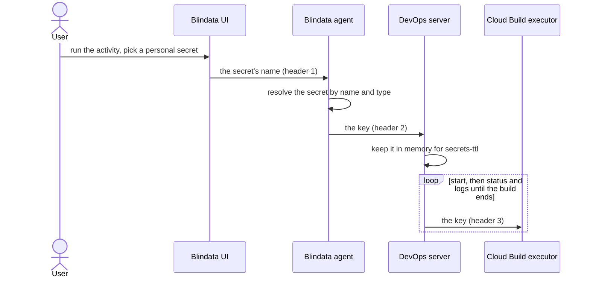

| Hop | Header | Value |
| --- | --- | --- |
| 1. UI → agent | `x-odm-ag-cloudbuild-executor-secret-gcp-service-account-key` | The name of the user's personal secret, never its value |
| 2. Agent → DevOps | `x-odm-cloudbuild-executor-secret-gcp-service-account-key` | The key, resolved by the agent from the personal secret |
| 3. DevOps → executor | `x-odm-gcp-service-account-key` | The key, on every call of the activity |

- DevOps keeps the executor's secret headers for the activity, renamed to `x-odm-<secretType>`.
- `cloudbuild` in the header names is the executor name declared in DevOps and in the agent; `gcp-service-account-key` is the secret type.

## API reference

All four calls are `POST` under `/api/v2/up/executor/tasks/`, and every body carries `executorParameters`. OpenAPI is served at `/api-docs`, Swagger UI at `/swagger-ui`.

| Path | Request body | Response |
| --- | --- | --- |
| `/start` | `{ "executorParameters", "pipelineParameters" }` | `{ "providerRunId" }`: the build resource name |
| `/status` | `{ "executorParameters", "providerRunId" }` | `{ "providerRunId", "status" }` |
| `/logs` | `{ "executorParameters", "providerRunId" }` | `{ "content", "generatedAt" }` |
| `/cancel` | `{ "executorParameters", "providerRunId" }` | empty **200** |

`executorParameters`:

| Field | Use |
| --- | --- |
| `pipelineIdentifier` | **Required.** The name of the Cloud Build trigger to run. |
| `ref.name` | **Required.** The branch or tag to build. For a release, DevOps sends the version's tag. |
| `ref.type` | **Required.** `BRANCH` or `TAG`: the trigger runs with `branchName` or `tagName`. |
| `dataProductRepo`, `repositoryKey` | Ignored: the trigger already binds the repository. |

Error statuses are listed under [Errors](#errors).

## Limits and open points

These Cloud Build behaviours are not stated in Google's reference and are to be confirmed against a real 2nd-generation trigger:

- whether `triggers.get` resolves a trigger by name (the executor falls back to listing the triggers);
- whether `triggers:run` accepts a branch or tag for 2nd-generation (repository connection) triggers;
- whether substitutions passed to `triggers:run` are merged with the trigger's defaults or replace them;
- the shape of the operation returned by `triggers:run` (the executor reads `metadata.build.id`, then `metadata.build.name`);
- the Cloud Logging filter for a build's entries.

Other limits: child builds started by a build are not followed; the native build has not been run yet for this service.
