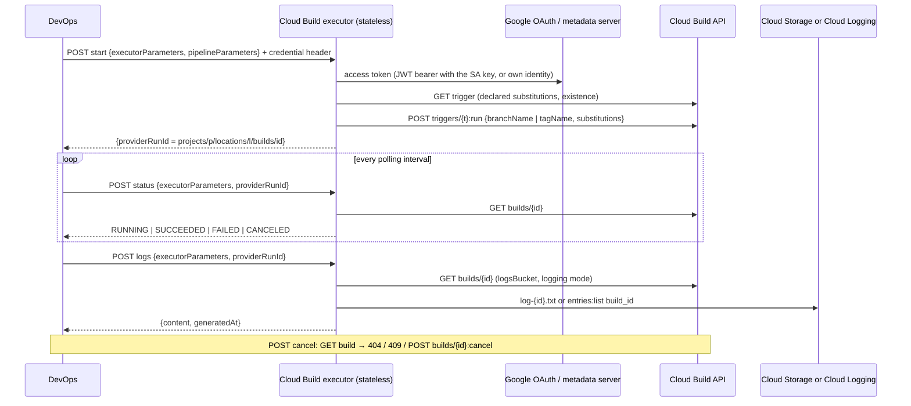

# SPDD Analysis: Cloud Build DevOps executor

Story **BDMD-5810** (epic BDMD-5632). Repository `odm-platform-adapter-devops-executor-cloudbuild`. It implements the DevOps executor API (start, status, logs, cancel) for Google Cloud Build. It uses the same contract as the GitLab executor (`odm-platform-adapter-devops-executor-gitlab`, BDMD-5099).

**Revision 1 (2026-11-25).** First draft for review. The story was conditional on the customer of a PoC running its pipelines on Cloud Build. The customer side confirmed this on 2026-11-24, and the team then decided the executor is needed. The story moved to Sprint 156 on 2026-11-25.

Sources used:

- the GitLab executor: its README, its SPDD analysis (`spdd/analysis/BDMD-5099-*`), and its code (use cases, `RestUtils`, error mapping, the stubbed integration tests);
- the DevOps server: `ExecuteActivity.validateExecutorParameters` (it requires `ref.name` and `ref.type`) and `ExecutorParameters`;
- the Blindata agent: `OdmProxyConfig.ExecutorConfig` (`specification`, `specificationVersion`, `secrets[].secretType`);
- the Blindata UI: `ExecuteDevOpsV2ActivityFlow.js` (it builds `executorParameters` from the descriptor task and the registry repository) and `DEVOPS_V2_PIPELINE_IDENTIFIER_REQUIRED_PROVIDERS`;
- the template render in this repo (`blindata-backend-service-template-quarkus` 1.1.1, modules `usecases`, `http-service`, `rest-client`);
- the team knowledge wiki: the decision "DevOps executor configuration: specification names match the Git provider names";
- Google's documentation, read on 2026-11-25: the Cloud Build REST reference (`triggers:run`, `builds.get`, `builds.cancel`, `Build`, `RepoSource`), build log storage, substitutions, Cloud Build IAM roles, the OAuth 2.0 service-account flow, service-account key restrictions, and short-lived credentials. The gaps the docs leave are listed under Technical Risks. The spike closes them.

## Original Business Requirement

Customer and partner names are redacted as `[customer]` and `[partner]` in the verbatim texts below, because this repository is public.

Request in chat (2026-11-25): "On [customer] most recent developments, we reached the need for a cloudbuild devops executor. 1. find the ticket 2. move in the current sprint (in progress assigned to me) 3. Start working on it (new repository)"

Jira BDMD-5810, "[[customer]] Executor DevOps per Cloud Build (condizionale: solo se GitLab non può eseguire pipeline nell'ambiente [customer])", description, verbatim:

> ⚠️ **Condizionale.** Diventa necessaria **solo se [customer] o [partner] indicano che GitLab non può eseguire pipeline nel loro ambiente**. Fino ad allora resta in backlog: la PoC usa il GitLab executor.
>
> **Obiettivo.** Un executor DevOps V2 per Google Cloud Build, con lo stesso contratto del GitLab executor (`odm-platform-adapter-devops-executor-gitlab`): `start`, `status`, `logs` e `cancel`, stateless, credenziale in `x-odm-token`.
>
> **Fattibilità: sì.** Si possono riusare circa metà del codice (controller, use case, client REST, mappatura errori, IT con stub) e la stessa catena di secret agent → DevOps. Il lavoro vero sta nell'**autenticazione GCP** e nei **log**.
>
> ## Flusso
>
> ```
> Blindata agent ──► DevOps server ──► Executor Cloud Build ──► Cloud Build API (progetto cliente)
>  secret personale   polling 30s       Quarkus, stateless
>                     secret TTL 4h     x-odm-token = credenziale GCP
> ```
>
> | Chiamata executor | API Cloud Build | Fit |
> |---|---|---|
> | `start` | `projects/{p}/locations/{l}/triggers/{t}:run` (branch o tag, substitutions `_X`) → operation con il build id | ✅ |
> | `providerRunId` | nome completo `projects/{p}/locations/{l}/builds/{id}` (nessuno stato nell'executor) | ✅ |
> | `status` | `builds.get` | ✅ |
> | `cancel` | `builds:cancel` (409 se la build è già finita, come GitLab) | ✅ |
> | `logs` | Cloud Logging `entries:list` filtrato su `build_id`, **oppure** il file GCS `log-{id}.txt` se la build ha un `logsBucket` | ⚠️ due percorsi, due permessi |
>
> **Mappatura stati**
>
> | Cloud Build | Executor |
> |---|---|
> | `PENDING` · `QUEUED` · `WORKING` | 🔵 `RUNNING` |
> | `SUCCESS` | 🟢 `SUCCEEDED` |
> | `FAILURE` · `INTERNAL_ERROR` · `TIMEOUT` · `EXPIRED` | 🔴 `FAILED` |
> | `CANCELLED` | 🟡 `CANCELED` |
>
> ## Differenze rispetto a GitLab
>
> - **Dove gira la pipeline.** Servono progetto GCP, region e trigger. `executorParameters.pipelineIdentifier` esiste già (GitLab lo ignora) e può contenere il nome del trigger. `ref.type` (BRANCH/TAG) diventa obbligatorio, perché `triggers:run` prende `branchName` oppure `tagName`.
> - **Spec agent/UI.** Cloud Build non è un Git provider: la spec dell'executor nell'agent e nella UI richiede progetto GCP e region, non un base URL.
> - **Input.** Non c'è un equivalente di `spec:inputs`. I parametri diventano substitutions `_KEY` (da decidere se aggiungere il prefisso `_`); le substitutions di default del trigger fanno da "input dichiarati" per il filtro. Una substitution che la config non usa fa fallire la build, a meno di `ALLOW_LOOSE`: va documentata. In compenso non serve il retry 503 sulla cache degli input.
> - **Repo.** Va collegato a Cloud Build (connessioni 2nd gen: GitHub, GitLab, Bitbucket) e serve un trigger.
>
> ## Avvio della build: tre opzioni
>
> | | A. Trigger esistente → `triggers:run` ✅ **consigliata** | B. L'executor crea il trigger | C. Nessun trigger → `builds.create` |
> |---|---|---|---|
> | Setup cliente | trigger creato una volta per repo | nessun trigger manuale (nome fisso `odm-<repo>`) | nessun trigger |
> | Permessi executor | solo run | `cloudbuild.builds.editor` | creazione build |
> | Secret | 1 (GCP) | 1 (GCP) | 2 (Git + GCP): legge `cloudbuild.yaml` al ref e lo converte in JSON |
> | Stato | stateless | lascia risorse nel progetto | stateless |
> | Rischi | repo collegato | repo comunque collegato | repo privati senza connected repository: da verificare |
>
> ## Autenticazione (scelta principale)
>
> | Opzione | Fit |
> |---|---|
> | **A. Chiave JSON di service account** come secret personale (base64, una riga, circa 3 KB). L'executor genera un access token a ogni richiesta (firma con il JDK, senza librerie Google) | ✅ è la più vicina al flusso attuale. ⚠️ Molti clienti bloccano la creazione delle chiavi (`iam.disableServiceAccountKeyCreation`) |
> | **B. Access token OAuth incollato** | ❌ scade in 1h, mentre il polling può durare fino a 4h |
> | **C. Identità dell'executor** (Workload Identity / ADC su GKE o Cloud Run), eventualmente con impersonation di un SA indicato nel secret | ✅ la più sicura e quella che si aspetta un cliente GCP. ⚠️ le run non usano più la credenziale del singolo utente |
>
> Raccomandazione: **A + C**. L'OAuth Google con refresh token rientra nell'analisi OAuth (BDMD-5635).
>
> ## Piano
>
> 1. **Spike (1–2 gg):** verificare che `triggers:run` funzioni con repo GitHub/GitLab collegati in 2nd gen, e quale percorso dei log si usa con un service account utente (Cloud Logging only oppure bucket custom).
> 2. Nuovo repo `odm-platform-adapter-devops-executor-cloudbuild` dal template Quarkus; API REST via HTTP come nel GitLab executor (niente librerie Google Cloud, per non complicare la build nativa).
> 3. Spec executor nell'agent e nella UI (progetto, region, tipo di secret) e config del DevOps server.
>
> **Stima:** di dimensioni simili al GitLab executor (circa 2,3k righe non-utility): meno lavoro sugli input, più su autenticazione e log.
>
> **Fonti.** Codice: `odm-platform-adapter-devops-executor-gitlab` (README, `StartTask`), `odm-platform-pp-devops-server` (`ExecutorParameters`, `ExecutorSecretsStoreImpl`), `blindata-agent` (`OdmProxyConfig.ExecutorSecretConfig`). Wiki: `wiki/decisions/devops-executor-spec-names-match-git-provider-names.md`. Le API Cloud Build sono citate a memoria: lo spike le conferma.

Jira comments, verbatim:

> **Aggiornamento 23/11:** la domanda "GitLab come orchestratore che chiama Cloud Build, oppure solo Cloud Build?" è stata inviata a [partner] nella mail del 23/11. La nostra proposta è GitLab come orchestratore. Aspettiamo la risposta prima dell'incontro di venerdì 27/11. Questa story serve solo se [customer] vuole tutto su Cloud Build: in quel caso va sviluppato l'executor DevOps per Cloud Build.

> **Aggiornamento 24/11:** [partner] conferma per mail che le pipeline di [customer] girano su **Cloud Build**. La condizione di questa storia è quindi probabile; resta senza sprint finché il meeting del 27/11 non conferma se GitLab può orchestrare o se serve l'executor Cloud Build.

## Domain Concept Identification

### Existing Concepts (from codebase)

- **Executor API** (DevOps server `client.executor`; GitLab executor `ExecutorTaskController`): four `POST` calls under `/api/v2/up/executor/tasks/` (`start`, `status`, `logs`, `cancel`). Every body carries `executorParameters`. Start adds `pipelineParameters`, the others add `providerRunId`. The status vocabulary is `RUNNING`, `SUCCEEDED`, `FAILED`, `CANCELED`. This story does not change the API.
- **Executor parameters** (`ExecutorParameters` in DevOps; built by the UI in `ExecuteDevOpsV2ActivityFlow.js`):
  - `dataProductRepo`, the registry repository record. For the PoC it is a GitLab repository, because GitLab stays the repository host.
  - `ref`, with `name` and `type` (`BRANCH` or `TAG`). DevOps already rejects a full-control task without `ref.type`. For a release, the UI fills the ref from the version's tag.
  - `pipelineIdentifier`, a provider-neutral string. It comes from the descriptor's task definition. The UI warns when it is missing only for the repository providers in `DEVOPS_V2_PIPELINE_IDENTIFIER_REQUIRED_PROVIDERS` (`GITHUB`, `AZURE`).
  - `repositoryKey`, for the non-main repositories.
- **Pipeline parameters**: free key-value strings from the descriptor task's `configurations.params`. They are not secret. DevOps rejects blank keys and null values.
- **Provider run id**: an opaque string of at most 255 characters. DevOps stores it and sends it back on every later call.
- **Executor secrets and their header lifecycle**: UI → agent (`x-odm-ag-<executor>-executor-secret-<type>`: the name of a personal secret) → DevOps (`x-odm-<executor>-executor-secret-<type>`: the value) → DevOps in-memory cache for `secrets-ttl` → executor (`x-odm-<type>`). The agent declares the secret types per executor in `servicesConfigurations.devops.executors.<name>.secrets[].secretType`. The secret type is free text, so a new type needs no agent or DevOps code change.
- **Executor declaration in the agent** (`ExecutorConfig`): `specification`, `specificationVersion` and `secrets`. The UI copies the specification into the descriptor's task template. There is no project, region or base URL field.
- **Polling and the secrets TTL** (DevOps): fixed polling interval (default 30 s). The number of polls is `secrets-ttl` divided by the interval, so the TTL caps how long a run can last.
- **GitLab executor building blocks** to reuse: the controller and resources, the four use cases with their outbound ports and presenters, `RunStatus`, the exception hierarchy and `ExecutorGitlabApiExceptionMapper`, the `RestUtils` toolkit with its client exceptions, the "header names only" logging rule, the `ConfigMapping` configuration with its start-up validator, and the stubbed integration tests (`*IT`, `GitLabStub`).
- **This repo**: rendered from template 1.1.1 with `usecases`, `http-service` and `rest-client`. It carries the starter's Dockerfile, CI workflows and README, and has no service code yet. The `rest-client` module brings `java-jwt` (Auth0), which can sign RS256 JWTs.

### New Concepts Required

- **Cloud Build trigger**: the customer-owned definition of a pipeline. It binds a connected repository, a build config file (for example `cloudbuild.yaml`), default substitutions and the service account the build runs as. It is identified by `projects/{project}/locations/{location}/triggers/{triggerId}`. The executor runs it and never creates or edits it.
- **Cloud Build build**: one run of a trigger at a ref. One DevOps task maps to one build.
- **Build resource name**: `projects/{project}/locations/{location}/builds/{buildId}`. It is the provider run id, so status, logs and cancel need nothing else.
- **Pipeline location**: project, location and trigger. It is read from `pipelineIdentifier`, with defaults from the executor configuration.
- **Substitutions**: the build's user-defined parameters, keys matching `_[A-Z0-9_]+`. Pipeline parameters reach Cloud Build only as substitutions.
- **GCP credential**: what the executor uses to obtain a short-lived OAuth access token for one request. It is either a service-account key sent in a secret header, or the executor's own identity (optionally impersonating a service account).
- **Build log source**: a Cloud Storage object `log-{buildId}.txt` in the build's logs bucket, or Cloud Logging entries for the build.
- **Allowed projects**: optional executor configuration that limits the GCP projects the executor will call.

### Key Business Rules

Explicit:

- **The executor is stateless.** It keeps no run, no credential and no access token between requests. Configuration is not state.
- **Same contract as the GitLab executor**: four `POST` calls, `executorParameters` on every call, the four statuses, 404 for an unknown run, 409 for a cancel of an ended run.
- **The run is started from an existing trigger** (`triggers:run`, option A of the ticket). The executor needs run permission only.
- **`ref.type` decides branch or tag**: a branch ref is sent as `branchName`, a tag ref as `tagName`.
- **Status mapping**: `PENDING`, `QUEUED`, `WORKING` → `RUNNING`; `SUCCESS` → `SUCCEEDED`; `FAILURE`, `INTERNAL_ERROR`, `TIMEOUT`, `EXPIRED` → `FAILED`; `CANCELLED` → `CANCELED`.
- **No Google Cloud client libraries.** Plain HTTPS calls, as in the GitLab executor, to keep the native build simple.
- Credentials are never logged, returned or put in events. Only header names may be logged.

Implicit:

- **Every `CANCELLED` build is `CANCELED`**, whoever canceled it (DevOps, the console, or `gcloud`). Same rule as GitLab.
- **`STATUS_UNKNOWN` and any unlisted value map to `RUNNING`**, so the DevOps poll cap bounds the wait.
- **The token host is fixed** (`*.googleapis.com`). Request data cannot redirect a credential to another host, unlike GitLab's `providerBaseUrl`. The project allow-list is a scope guard, not an exfiltration guard.
- **`pipelineIdentifier` becomes required** for this executor, whatever the repository provider. The UI warning list keys on the repository provider (`GITHUB`, `AZURE`), so it will not warn for a GitLab repository built on Cloud Build.
- **Running a trigger requires `iam.serviceAccounts.actAs`** on the trigger's service account (role `roles/iam.serviceAccountUser`), on top of `cloudbuild.builds.create`. Cancel requires `cloudbuild.builds.update`, which among predefined roles only `roles/cloudbuild.builds.editor` has.
- **Builds run by a trigger use `ALLOW_LOOSE` substitutions**, per the docs, so an unused substitution does not fail the build. The docs do not name `triggers:run` explicitly, so the spike checks it.

## Strategic Approach

### Solution Direction

- **Port the GitLab executor's shape, swap the provider gateway.** Keep the controller, resources, use cases, presenters, status vocabulary and error mapping. Replace the GitLab outbound ports with Cloud Build ones.
  - **start**: resolve the pipeline location (decision 2), get an access token (decision 6), read the trigger, build the substitutions (decision 4), run the trigger on the ref, and return the build resource name.
  - **status**: read the build and map its status.
  - **logs**: read the build, then read its log from Cloud Storage or Cloud Logging (decision 7), bounded in size.
  - **cancel**: read the build. Return 404 if it is unknown and 409 if it has ended. Otherwise cancel it.
- **Plain REST over HTTPS** with the template's `RestUtils`: Cloud Build v1, Cloud Storage JSON API (object media download), Cloud Logging v2 `entries:list`, and the OAuth token endpoint.
- **Start with a spike** (ticket plan step 1) against Blindata's replica of the customer stack, in its own GCP and GitLab organisation. Its findings close the doc gaps under Technical Risks before the canvas fixes the details.
- **Document**: README (pipeline location, credential setup, IAM roles, substitutions, statuses, logs), plus the agent, DevOps and UI configuration for a Cloud Build executor.



### Statelessness check

| Concern | Without state, how | Verdict |
|---|---|---|
| Finding the run again | The provider run id is the full build resource name, so project and location come with it. | Holds |
| Credentials | DevOps sends the credential header on every call. The executor builds an access token per request and drops it. | Holds, one token exchange per call (about one every 30 s per running task) |
| Executor identity mode | The metadata server gives a token per request. No state in the executor. | Holds |
| 404/409 on cancel | Read the build before canceling, in the same request. | Holds |
| Declared substitutions | Read from the trigger at every start. | Holds, one extra call per start |
| Start idempotency | A retried start runs a second build. DevOps does not retry start, and the executor must not retry `triggers:run`. | Accepted residual risk, as for GitLab |

### Key Design Decisions

1. **Same executor API, no change to DevOps.** The four endpoints, bodies, responses and error codes match the GitLab executor. The provider run id is the build resource name, about 110 characters, well under the 255 limit.

2. **Pipeline location: `pipelineIdentifier` names the trigger.**
   - Accepted forms: the full resource name `projects/{project}/locations/{location}/triggers/{triggerId}`, or a bare trigger id resolved with `default-project` and `default-location` from the executor configuration.
   - A missing `pipelineIdentifier` is a 400.
   - The docs identify the trigger by its service-generated id. Whether `triggers:run` also accepts the trigger's name is not documented: the spike checks it. Accepting names would be friendlier in a descriptor.
   - `dataProductRepo` is not used to locate the pipeline. The trigger already binds the repository.
   - Why not the executor spec (ticket "Spec agent/UI"): the agent's `ExecutorConfig` has no place for project or region, and the location differs per data product. The descriptor task already carries `pipelineIdentifier`, and the executor configuration supplies defaults. No agent change is needed.
   - **Recommendation**: full resource name in the descriptor, defaults for the short form. The project must be in `allowed-projects` when that list is set.

3. **Starting a build: option A, run an existing trigger.**
   - `POST v1/projects/{p}/locations/{l}/triggers/{t}:run`, body `source` with `branchName` or `tagName` from `ref`, plus `substitutions`.
   - The response is a long-running operation. The executor reads the build id from it, without waiting for the operation to finish.
   - The ref is sent as given. The `triggers:run` page says branch and tag names cannot be regular expressions, while `RepoSource` describes `branchName` as a regex. The spike checks that a plain name works.
   - **Open (spike)**: the `triggers:run` page describes `RepoSource` as a Cloud Source Repositories source and does not mention 2nd-gen repository connections. The PoC repository is on GitLab, so the trigger is a 2nd-gen one. If `triggers:run` refuses a ref override on a 2nd-gen trigger, the fallback is option C of the ticket (`builds.create` with the config read from the repository), which needs a second secret.

4. **Pipeline parameters → substitutions, selected against the trigger's substitutions.**
   - Key normalisation: a parameter name becomes `_` + upper case, with characters outside `[A-Z0-9_]` replaced by `_` (`env` → `_ENV`). A name that already has the `_` prefix keeps it.
   - Selection: the trigger's default substitutions play the role of GitLab's declared inputs. A normalised parameter that matches a trigger substitution is sent. Other parameters are dropped, and their names (never values) go to the executor's log at start.
   - There is no "required" flag on substitutions, so there is no 400 for a missing parameter. The trigger default applies.
   - Limits: at most 200 substitutions, key at most 100 bytes, value at most 4000 bytes. A larger value is a 400 before any call to Cloud Build.
   - Alternative: send every parameter and rely on `ALLOW_LOOSE`. Simpler, but a typo silently does nothing and nothing is logged. The selection keeps the GitLab behaviour.
   - **Open (spike)**: whether `source.substitutions` on `triggers:run` merges with or replaces the trigger's defaults. The docs do not say.

5. **Status mapping** as in the ticket, plus `STATUS_UNKNOWN` and any unlisted value → `RUNNING`. `TIMEOUT` (default build timeout 60 min) and `EXPIRED` (queued longer than `queueTtl`) are `FAILED`.

6. **Credentials: two modes, chosen per request by the secret header present.**

   | Mode | Secret type (header) | What the executor does | Fit |
   |---|---|---|---|
   | A. Service-account key | `gcp-service-account-key` (`x-odm-gcp-service-account-key`): the JSON key, base64 on one line | Signs a JWT (RS256, `java-jwt` and the JDK key factory), exchanges it at `https://oauth2.googleapis.com/token` (grant `jwt-bearer`, scope `cloud-platform`), uses the token for this request only | Closest to the current per-user secret flow. Blocked where the org enforces `iam.disableServiceAccountKeyCreation`, which is on by default for organisations created on or after 3 May 2024 |
   | C. Executor identity | none, or `gcp-service-account` (`x-odm-gcp-service-account`): a service-account email to impersonate | Gets its own token from the metadata server. With an email, calls `iamcredentials ... :generateAccessToken` for that account (needs `roles/iam.serviceAccountTokenCreator`) | The most secure and what a GCP customer expects. The executor must run on GCP (Cloud Run, GKE), and runs no longer use the individual user's credential |

   - Mode C is enabled by configuration (`identity.enabled`). With it off, a request without a key header is a 400 naming the expected header.
   - Option B of the ticket (a pasted OAuth access token) is rejected: it expires in 1 h, while polling may last 4 h.
   - The self-signed JWT shortcut (no token exchange) works only for some Google APIs, and the docs do not list Cloud Build. The spike checks it. If it works, it saves one call per request.
   - Secret type names are proposals. The ticket title says `x-odm-token`. A dedicated type per mode makes the header self-describing and lets the agent declare exactly what the UI must ask for.

7. **Logs: read the build, then pick the source.**
   - If the build has a `logsBucket` and its logging mode stores to Cloud Storage (`LEGACY` or `GCS_ONLY`), read `log-{buildId}.txt` from that bucket.
   - Otherwise (`CLOUD_LOGGING_ONLY`), read Cloud Logging entries for the build, oldest first, following pages.
   - `NONE` returns a note that the build stores no logs, not an error.
   - The block is bounded in size, and truncation is marked. Logs are read once, after the run ends.
   - Permissions differ: `roles/storage.objectViewer` (and `roles/logging.viewAccessor` for a user-owned bucket) for Cloud Storage, `roles/logging.viewer` for Cloud Logging. A missing permission returns a log block that says which permission is missing, not a failure of the task.
   - **Open (spike)**: the Cloud Logging filter for a build (`resource.type="build"` and `resource.labels.build_id` are expected, not found in the docs read), and which path the customer's builds use.

8. **Cancel on a build that may have ended.** Read the build first: unknown → 404; `SUCCESS`, `FAILURE`, `INTERNAL_ERROR`, `TIMEOUT`, `EXPIRED`, `CANCELLED` → 409; otherwise `POST builds/{id}:cancel` → 200. The docs do not document the error code for canceling an ended build, so the executor does not rely on it.

9. **Error mapping.** Google errors carry `code`, `message` and `status`. Mapping: `INVALID_ARGUMENT` or `FAILED_PRECONDITION` at start → 400 with Google's message; `NOT_FOUND` → 404; `UNAUTHENTICATED` and `PERMISSION_DENIED` → 502 with the missing permission named when Google gives it (same class as GitLab's "token refused"); `RESOURCE_EXHAUSTED` and `UNAVAILABLE` → 502 after a bounded retry on reads. Never retry `triggers:run` or `:cancel`.

10. **Template and repository.** Already done for this story: starter import on `main`, then template 1.1.1 rendered with `usecases`, `http-service` and `rest-client` and merged on the feature branch. `persistence` is not needed (stateless). `java-jwt`, which the GitLab executor carried unused, is used here for the JWT.

11. **Executor naming in the agent and UI.** Executor name `cloudbuild`, `specification: CloudBuild`, `specificationVersion: 1.0.0`, secrets as in decision 6. The decision "specification names match the Git provider names" does not cover an executor that is not a Git provider; `CloudBuild` follows the same style. The UI needs a rule that `pipelineIdentifier` is required when the task's executor specification is `CloudBuild`. That UI change is outside this repository: a follow-up story.

### Alternatives Considered

- **Option B, the executor creates the trigger** (`odm-<repo>`). Rejected: it leaves resources in the customer project and needs trigger-edit rights.
- **Option C, `builds.create` from the repository config.** Kept only as the fallback if the spike shows `triggers:run` cannot set the ref on 2nd-gen triggers. It needs a Git secret too, and has to convert `cloudbuild.yaml` to the Build JSON.
- **GitLab as orchestrator calling Cloud Build.** This was Blindata's proposal of 2026-11-23. The customer side replied on 2026-11-24 that its pipelines run on Cloud Build, with GitLab as repository only, and the team decided on 2026-11-25 to support Cloud Build directly.
- **Google Cloud client libraries.** Rejected: heavier native image and reflection configuration, for four REST calls and a token exchange.
- **An access-token cache in the executor.** Rejected: it breaks the "no secret cache" rule of the GitLab review. The cost is one token call per request.
- **Project and region in the agent's executor spec** (ticket "Spec agent/UI"). Rejected for the first version: `ExecutorConfig` has no such fields, and the location is per data product. `pipelineIdentifier` plus executor defaults covers it.

### Suggested service configuration

**Executor** (`application.yaml`):

```yaml
executor:
  cloudbuild:
    default-project:                    # used with a bare trigger id in pipelineIdentifier
    default-location: global            # or the trigger's region, for example europe-west8
    allowed-projects: []                # empty = any project the credential can reach
    identity:
      enabled: false                    # mode C: metadata server, optional impersonation
    http:
      connect-timeout: 5s
      read-timeout: 30s
      read-retries: 2                   # reads only; never triggers:run or cancel
    logs:
      max-size: 5MB
```

**DevOps server**: declare `cloudbuild` as `full-control` at the executor's address, with `secrets-ttl` above the longest build (the 4 h of the GitLab advice still applies).

**Blindata agent**: `servicesConfigurations.devops.executors.cloudbuild` with `specification: CloudBuild` and the secret type of mode A. For mode C without impersonation, no secrets.

**Customer GCP**: a 2nd-gen connection to the GitLab repository, one trigger per pipeline, and for the calling principal: `roles/cloudbuild.builds.editor` (run, read, cancel), `roles/iam.serviceAccountUser` on the trigger's service account, and the log-reading role of decision 7.

Property names are proposals. The canvas fixes them.

## Risk & Gap Analysis

### Requirement Ambiguities

- **Credential mode for the PoC.** Does the customer allow service-account keys, or must the executor run on GCP with its own identity? This decides whether mode A, mode C, or both ship first.
- **Where the executor runs for the PoC.** On Blindata's demo infrastructure, mode A is the only option. Mode C needs a deployment on GCP.
- **Secret type names** (decision 6) versus the `x-odm-token` in the ticket.
- **Substitution selection** (decision 4): select against the trigger's substitutions, or send everything under `ALLOW_LOOSE`.
- **Trigger reference in the descriptor**: id, name, or full resource name.
- **Scope of the UI follow-up** (decision 11): required `pipelineIdentifier` for Cloud Build tasks, and the executor icon.

### Edge Cases

- **Trigger not found or in another location**: 404 at start, no build.
- **A trigger that ignores the requested ref** (for example a trigger bound to a fixed branch): the spike checks what Cloud Build does. If it runs the trigger's own ref, the build no longer matches the version. The executor must then refuse the ref mismatch or document the setup.
- **A tag ref on a trigger configured for branches**, and the reverse.
- **A parameter that normalises to the same key as another** (`env` and `ENV`): 400 naming both, before any call.
- **A build stuck in `QUEUED` or `PENDING`**: `RUNNING` until `queueTtl` expires (`EXPIRED`, so `FAILED`) or the DevOps poll cap ends the task.
- **A build that outlives `secrets-ttl`**: status calls arrive without the credential, and the task fails. In mode C without impersonation no header is needed, so the TTL does not cut the poll.
- **A build canceled in the console**: `CANCELED`, and the activity ends `CANCELED` without a cancel request in DevOps (same as GitLab).
- **The start response lost after Cloud Build accepted it**: an orphan build runs. No retry.
- **Logs not readable** (missing permission, `NONE` mode, a Google-owned bucket): a log block that explains why, and the task keeps its status.
- **A build with very large logs**: size bound and truncation mark.

### Technical Risks

- **Doc gaps on `triggers:run`** (read on 2026-11-25): 2nd-gen triggers are not mentioned; trigger name versus id; regex versus plain ref names; whether substitutions merge with or replace the trigger's; the operation metadata shape (the `BuildOperationMetadata` page returned 404). Mitigation: the spike runs every call against a real 2nd-gen trigger on the replica before the canvas.
- **Cancel and get error codes are not documented.** Mitigation: read-before-cancel (decision 8). The spike records the real codes for the stubs.
- **Cloud Logging filter not confirmed.** Mitigation: the spike; log source behind one outbound port.
- **Service-account keys blocked by org policy.** If the separate GCP organisation for the PoC (decided on 2026-10-27) is a new organisation, key creation is blocked there too by default. Mitigation: an organisation admin grants a policy exception for the PoC project, or mode C is used.
- **Header size.** A base64 key is about 3 KB. It travels agent → DevOps (Spring Boot, header limit 8 KB by default for all headers together) → executor (Quarkus). Mitigation: the spike runs the full chain. If it fails, raise the DevOps header limit.
- **One token exchange per call.** About one extra call every 30 s per running task. Acceptable. The self-signed JWT shortcut would remove it if Cloud Build accepts it.
- **API quotas.** The Cloud Build quotas page gives no numeric limit for reads. Polling every 30 s is low; the console's quota page shows the real limits.
- **Native image.** New JSON mappings (Build, Operation, Logging entries, OAuth token response) need reflection registration. A native build is part of the verification.
- **Testing without GCP in CI.** A stubbed Google API (as `GitLabStub`) scripts the documented and spike-recorded responses. A manual smoke test runs on the replica.

### Acceptance Criteria Coverage

The ticket has no explicit ACs. These are proposed for review.

| AC# | Description | Addressable? | Gaps/Notes |
|-----|-------------|--------------|------------|
| 1 | The executor implements start, status, logs and cancel with the same contract as the GitLab executor | Yes | Decision 1. |
| 2 | Start runs an existing Cloud Build trigger at the version's branch or tag and returns the build resource name | Partial | Decision 3. 2nd-gen ref override is a spike item; fallback is option C. |
| 3 | Status maps Cloud Build statuses to `RUNNING`, `SUCCEEDED`, `FAILED`, `CANCELED` | Yes | Decision 5. |
| 4 | Logs return one bounded block from Cloud Storage or Cloud Logging | Partial | Decision 7. The Cloud Logging filter is a spike item. |
| 5 | Cancel: 404 unknown, 409 ended, otherwise canceled | Yes | Decision 8. |
| 6 | Credentials: service-account key per request, and executor identity; never logged, returned or cached | Yes | Decision 6. Which mode the PoC uses is open. |
| 7 | Pipeline parameters reach Cloud Build as substitutions, selected against the trigger's substitutions | Yes | Decision 4. Merge semantics are a spike item. |
| 8 | The executor is stateless, uses no Google client libraries, and builds natively | Yes | Statelessness check; native build in verification. |
| 9 | Suggested configuration for executor, DevOps, agent and customer GCP (IAM, trigger) | Yes | Above. |
| 10 | The README documents setup, credentials, IAM, substitutions, statuses and logs | Yes | |
| 11 | UI requires `pipelineIdentifier` for Cloud Build tasks | No (out of repo) | Follow-up story in `blindata-ui` (decision 11). |

## Open questions to settle before `/spdd-reasons-canvas`

1. Credential mode for the PoC: A (key), C (identity), or both. Where does the executor run?
2. Secret type names (`gcp-service-account-key`, `gcp-service-account`) versus the generic `token`.
3. Substitution selection against the trigger (recommended) or send-all.
4. Trigger reference form in `pipelineIdentifier`.
5. Spike, on the replica of the customer stack (2nd-gen GitLab connection, one trigger): `triggers:run` with branch and tag on a 2nd-gen trigger, by id and by name; substitution merge; operation shape; get and cancel error codes; log path and Cloud Logging filter with a user-specified service account; self-signed JWT; the full header chain with a 3 KB key.
