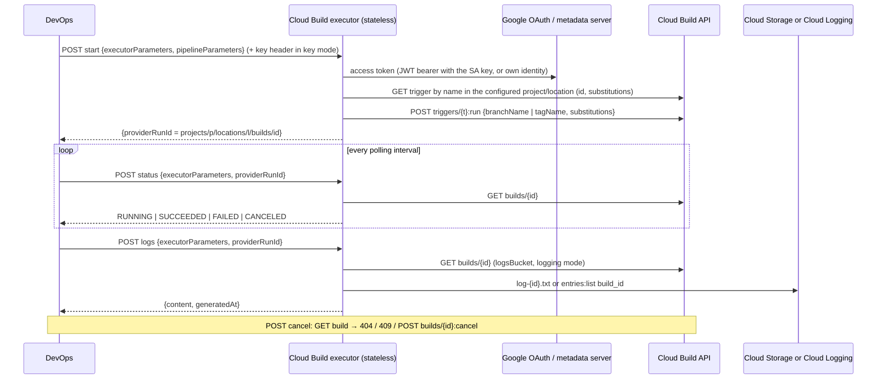

# SPDD Analysis: Cloud Build DevOps executor

Story **BDMD-5810** (epic BDMD-5632). Repository `odm-platform-adapter-devops-executor-cloudbuild`. It implements the DevOps executor API (start, status, logs, cancel) for Google Cloud Build. It uses the same contract as the GitLab executor (`odm-platform-adapter-devops-executor-gitlab`, BDMD-5099).

**Revision 2 (2026-11-25).** The review closed every ambiguity of revision 1 (outcome below, verbatim).

- **Both credential modes ship**: a service-account key in a personal secret, and the executor's own GCP identity. The mode is set in the executor's configuration, not chosen per request (decision 6).
- **The executor is built and documented for both deployments**: inside GCP (the PoC demo project, where it uses its own identity) and outside GCP (with a key).
- **Secret type names** were checked against the agent, the DevOps server and the UI. The only constraints are lowercase, header-safe text without `-executor-secret-`, so the key mode uses `gcp-service-account-key`, and the name is configurable (decision 6).
- **Substitution selection** against the trigger's substitutions is confirmed (decision 4).
- **The descriptor holds the trigger's name.** Project and location come from the executor's configuration only (decision 2).
- **The UI work** (pipeline-identifier help and a required check for Cloud Build tasks, on both UI lines) runs as separate work in `blindata-ui` (decision 11).

**Revision 1 (2026-11-25).** First draft for review. The story was conditional on the customer of a PoC running its pipelines on Cloud Build. The customer side confirmed this on 2026-11-24, and the team then decided the executor is needed. The story moved to Sprint 156 on 2026-11-25.

Sources used:

- the GitLab executor: its README, its SPDD analysis (`spdd/analysis/BDMD-5099-*`), and its code (use cases, `RestUtils`, error mapping, the stubbed integration tests);
- the DevOps server: `ExecuteActivity.validateExecutorParameters` (it requires `ref.name` and `ref.type`) and `ExecutorParameters`;
- the DevOps server's secret rewrite (`ExecuteActivitySecretsOutboundPortImpl`: it lowercases the `x-odm-<executor>-executor-secret-` prefix and forwards `x-odm-<secretType>`);
- the Blindata agent: `OdmProxyConfig.ExecutorConfig` (`specification`, `specificationVersion`, `secrets[].secretType`), `ODMProxyService` (secret header resolution and the required-secrets check, both on lowercased types) and `PersonalSecret` (free-text `secret_type`, `encrypted_secret` stored as `text`);
- the Blindata UI: `ExecuteDevOpsV2ActivityFlow.js` (it builds `executorParameters` from the descriptor task and the registry repository), `DEVOPS_V2_PIPELINE_IDENTIFIER_REQUIRED_PROVIDERS`, `getPipelineIdentifierHint` (`activityContentUtils.ts`), and the secret types it collects from the agent configuration (`getDefaultSecrets` in `DataOpsRoutes.jsx`);
- the template render in this repo (`blindata-backend-service-template-quarkus` 1.1.1, modules `usecases`, `http-service`, `rest-client`);
- the team knowledge wiki: the decision "DevOps executor configuration: specification names match the Git provider names";
- Google's documentation, read on 2026-11-25: the Cloud Build REST reference (`triggers:run`, `builds.get`, `builds.cancel`, `Build`, `RepoSource`), build log storage, substitutions, Cloud Build IAM roles, the OAuth 2.0 service-account flow, service-account key restrictions, and short-lived credentials. The gaps the docs leave are listed under Technical Risks. The spike closes them.

## Original Business Requirement

Customer and partner names are redacted as `[customer]` and `[partner]` in the verbatim texts below, because this repository is public.

Request in chat (2026-11-25): "On [customer] most recent developments, we reached the need for a cloudbuild devops executor. 1. find the ticket 2. move in the current sprint (in progress assigned to me) 3. Start working on it (new repository)"

Jira BDMD-5810, "[[customer]] Executor DevOps per Cloud Build (condizionale: solo se GitLab non può eseguire pipeline nell'ambiente [customer])", description, verbatim:

> ⚠️ **Condizionale.** Diventa necessaria **solo se [customer] o [partner] indicano che GitLab non può eseguire pipeline nel loro ambiente**. Fino ad allora resta in backlog: la PoC usa il GitLab executor.
>
> **Obiettivo.** Un executor DevOps V2 per Google Cloud Build, con lo stesso contratto del GitLab executor (`odm-platform-adapter-devops-executor-gitlab`): `start`, `status`, `logs` e `cancel`, stateless, credenziale in `x-odm-token`.
>
> **Fattibilità: sì.** Si possono riusare circa metà del codice (controller, use case, client REST, mappatura errori, IT con stub) e la stessa catena di secret agent → DevOps. Il lavoro vero sta nell'**autenticazione GCP** e nei **log**.
>
> ## Flusso
>
> ```
> Blindata agent ──► DevOps server ──► Executor Cloud Build ──► Cloud Build API (progetto cliente)
>  secret personale   polling 30s       Quarkus, stateless
>                     secret TTL 4h     x-odm-token = credenziale GCP
> ```
>
> | Chiamata executor | API Cloud Build | Fit |
> |---|---|---|
> | `start` | `projects/{p}/locations/{l}/triggers/{t}:run` (branch o tag, substitutions `_X`) → operation con il build id | ✅ |
> | `providerRunId` | nome completo `projects/{p}/locations/{l}/builds/{id}` (nessuno stato nell'executor) | ✅ |
> | `status` | `builds.get` | ✅ |
> | `cancel` | `builds:cancel` (409 se la build è già finita, come GitLab) | ✅ |
> | `logs` | Cloud Logging `entries:list` filtrato su `build_id`, **oppure** il file GCS `log-{id}.txt` se la build ha un `logsBucket` | ⚠️ due percorsi, due permessi |
>
> **Mappatura stati**
>
> | Cloud Build | Executor |
> |---|---|
> | `PENDING` · `QUEUED` · `WORKING` | 🔵 `RUNNING` |
> | `SUCCESS` | 🟢 `SUCCEEDED` |
> | `FAILURE` · `INTERNAL_ERROR` · `TIMEOUT` · `EXPIRED` | 🔴 `FAILED` |
> | `CANCELLED` | 🟡 `CANCELED` |
>
> ## Differenze rispetto a GitLab
>
> - **Dove gira la pipeline.** Servono progetto GCP, region e trigger. `executorParameters.pipelineIdentifier` esiste già (GitLab lo ignora) e può contenere il nome del trigger. `ref.type` (BRANCH/TAG) diventa obbligatorio, perché `triggers:run` prende `branchName` oppure `tagName`.
> - **Spec agent/UI.** Cloud Build non è un Git provider: la spec dell'executor nell'agent e nella UI richiede progetto GCP e region, non un base URL.
> - **Input.** Non c'è un equivalente di `spec:inputs`. I parametri diventano substitutions `_KEY` (da decidere se aggiungere il prefisso `_`); le substitutions di default del trigger fanno da "input dichiarati" per il filtro. Una substitution che la config non usa fa fallire la build, a meno di `ALLOW_LOOSE`: va documentata. In compenso non serve il retry 503 sulla cache degli input.
> - **Repo.** Va collegato a Cloud Build (connessioni 2nd gen: GitHub, GitLab, Bitbucket) e serve un trigger.
>
> ## Avvio della build: tre opzioni
>
> | | A. Trigger esistente → `triggers:run` ✅ **consigliata** | B. L'executor crea il trigger | C. Nessun trigger → `builds.create` |
> |---|---|---|---|
> | Setup cliente | trigger creato una volta per repo | nessun trigger manuale (nome fisso `odm-<repo>`) | nessun trigger |
> | Permessi executor | solo run | `cloudbuild.builds.editor` | creazione build |
> | Secret | 1 (GCP) | 1 (GCP) | 2 (Git + GCP): legge `cloudbuild.yaml` al ref e lo converte in JSON |
> | Stato | stateless | lascia risorse nel progetto | stateless |
> | Rischi | repo collegato | repo comunque collegato | repo privati senza connected repository: da verificare |
>
> ## Autenticazione (scelta principale)
>
> | Opzione | Fit |
> |---|---|
> | **A. Chiave JSON di service account** come secret personale (base64, una riga, circa 3 KB). L'executor genera un access token a ogni richiesta (firma con il JDK, senza librerie Google) | ✅ è la più vicina al flusso attuale. ⚠️ Molti clienti bloccano la creazione delle chiavi (`iam.disableServiceAccountKeyCreation`) |
> | **B. Access token OAuth incollato** | ❌ scade in 1h, mentre il polling può durare fino a 4h |
> | **C. Identità dell'executor** (Workload Identity / ADC su GKE o Cloud Run), eventualmente con impersonation di un SA indicato nel secret | ✅ la più sicura e quella che si aspetta un cliente GCP. ⚠️ le run non usano più la credenziale del singolo utente |
>
> Raccomandazione: **A + C**. L'OAuth Google con refresh token rientra nell'analisi OAuth (BDMD-5635).
>
> ## Piano
>
> 1. **Spike (1–2 gg):** verificare che `triggers:run` funzioni con repo GitHub/GitLab collegati in 2nd gen, e quale percorso dei log si usa con un service account utente (Cloud Logging only oppure bucket custom).
> 2. Nuovo repo `odm-platform-adapter-devops-executor-cloudbuild` dal template Quarkus; API REST via HTTP come nel GitLab executor (niente librerie Google Cloud, per non complicare la build nativa).
> 3. Spec executor nell'agent e nella UI (progetto, region, tipo di secret) e config del DevOps server.
>
> **Stima:** di dimensioni simili al GitLab executor (circa 2,3k righe non-utility): meno lavoro sugli input, più su autenticazione e log.
>
> **Fonti.** Codice: `odm-platform-adapter-devops-executor-gitlab` (README, `StartTask`), `odm-platform-pp-devops-server` (`ExecutorParameters`, `ExecutorSecretsStoreImpl`), `blindata-agent` (`OdmProxyConfig.ExecutorSecretConfig`). Wiki: `wiki/decisions/devops-executor-spec-names-match-git-provider-names.md`. Le API Cloud Build sono citate a memoria: lo spike le conferma.

Jira comments, verbatim:

> **Aggiornamento 23/11:** la domanda "GitLab come orchestratore che chiama Cloud Build, oppure solo Cloud Build?" è stata inviata a [partner] nella mail del 23/11. La nostra proposta è GitLab come orchestratore. Aspettiamo la risposta prima dell'incontro di venerdì 27/11. Questa story serve solo se [customer] vuole tutto su Cloud Build: in quel caso va sviluppato l'executor DevOps per Cloud Build.

> **Aggiornamento 24/11:** [partner] conferma per mail che le pipeline di [customer] girano su **Cloud Build**. La condizione di questa storia è quindi probabile; resta senza sprint finché il meeting del 27/11 non conferma se GitLab può orchestrare o se serve l'executor Cloud Build.

### Review outcome (2026-11-25), verbatim

Requirement Ambiguities

* ship both credential modes
* it runs inside gcp poc demo infrastructure (internal of the project). Anyway, build the executor for both scenarios and describe it well in the documentation
* for secret type names re-check the existing services (also the agent) if we need to satisfy specific patterns. The auth mode could be configured in the service config itself.
* Substitution selection: ok the proposed
* trigger reference: put the trigger's name in the descriptor, and take project and location from the executor's configuration
* Start a new session with the UI developments. (on both v1 and v2)

## Domain Concept Identification

### Existing Concepts (from codebase)

- **Executor API** (DevOps server `client.executor`; GitLab executor `ExecutorTaskController`): four `POST` calls under `/api/v2/up/executor/tasks/` (`start`, `status`, `logs`, `cancel`). Every body carries `executorParameters`. Start adds `pipelineParameters`, the others add `providerRunId`. The status vocabulary is `RUNNING`, `SUCCEEDED`, `FAILED`, `CANCELED`. This story does not change the API.
- **Executor parameters** (`ExecutorParameters` in DevOps; built by the UI in `ExecuteDevOpsV2ActivityFlow.js`):
  - `dataProductRepo`, the registry repository record. For the PoC it is a GitLab repository, because GitLab stays the repository host.
  - `ref`, with `name` and `type` (`BRANCH` or `TAG`). DevOps already rejects a full-control task without `ref.type`. For a release, the UI fills the ref from the version's tag.
  - `pipelineIdentifier`, a provider-neutral string. It comes from the descriptor's task definition. The UI warns when it is missing only for the repository providers in `DEVOPS_V2_PIPELINE_IDENTIFIER_REQUIRED_PROVIDERS` (`GITHUB`, `AZURE`).
  - `repositoryKey`, for the non-main repositories.
- **Pipeline parameters**: free key-value strings from the descriptor task's `configurations.params`. They are not secret. DevOps rejects blank keys and null values.
- **Provider run id**: an opaque string of at most 255 characters. DevOps stores it and sends it back on every later call.
- **Executor secrets and their header lifecycle**: UI → agent (`x-odm-ag-<executor>-executor-secret-<type>`: the name of a personal secret) → DevOps (`x-odm-<executor>-executor-secret-<type>`: the value) → DevOps in-memory cache for `secrets-ttl` → executor (`x-odm-<type>`). The agent declares the secret types per executor in `servicesConfigurations.devops.executors.<name>.secrets[].secretType`. The secret type is free text, so a new type needs no agent or DevOps code change.
- **Secret type naming, as the code enforces it**:
  - no format check anywhere: the agent, DevOps and the UI take the type as free text;
  - the agent lowercases the types when it checks that every declared secret is present, and DevOps lowercases the header prefix before forwarding `x-odm-<secretType>`. The agent then looks up the personal secret by the exact type. A type must therefore be lowercase to match the same way at every hop;
  - the type ends up in an HTTP header name, so it must be a header token (letters, digits, `-`), and it must not contain `-executor-secret-`, which the agent and DevOps use to split the header;
  - the types in use are lowercase kebab-case: `token` (executors) and `gitlab-pat` (Git providers);
  - a personal secret's value is stored as `text`, so a 3 KB key fits.
- **Executor declaration in the agent** (`ExecutorConfig`): `specification`, `specificationVersion` and `secrets`. The UI copies the specification into the descriptor's task template. There is no project, region or base URL field.
- **Polling and the secrets TTL** (DevOps): fixed polling interval (default 30 s). The number of polls is `secrets-ttl` divided by the interval, so the TTL caps how long a run can last.
- **GitLab executor building blocks** to reuse: the controller and resources, the four use cases with their outbound ports and presenters, `RunStatus`, the exception hierarchy and `ExecutorGitlabApiExceptionMapper`, the `RestUtils` toolkit with its client exceptions, the "header names only" logging rule, the `ConfigMapping` configuration with its start-up validator, and the stubbed integration tests (`*IT`, `GitLabStub`).
- **This repo**: rendered from template 1.1.1 with `usecases`, `http-service` and `rest-client`. It carries the starter's Dockerfile, CI workflows and README, and has no service code yet. The `rest-client` module brings `java-jwt` (Auth0), which can sign RS256 JWTs.

### New Concepts Required

- **Cloud Build trigger**: the customer-owned definition of a pipeline. It binds a connected repository, a build config file (for example `cloudbuild.yaml`), default substitutions and the service account the build runs as. It is identified by `projects/{project}/locations/{location}/triggers/{triggerId}`. The executor runs it and never creates or edits it.
- **Cloud Build build**: one run of a trigger at a ref. One DevOps task maps to one build.
- **Build resource name**: `projects/{project}/locations/{location}/builds/{buildId}`. It is the provider run id, so status, logs and cancel need nothing else.
- **Pipeline location**: project, location and trigger. Project and location come from the executor configuration. The trigger's name comes from `pipelineIdentifier`.
- **Substitutions**: the build's user-defined parameters, keys matching `_[A-Z0-9_]+`. Pipeline parameters reach Cloud Build only as substitutions.
- **Auth mode**: set once in the executor configuration. `service-account-key` reads a key from a secret header on every request. `workload-identity` uses the executor's own identity, optionally impersonating a configured service account.
- **GCP credential**: what the executor uses to obtain a short-lived OAuth access token for one request, according to the auth mode.
- **Build log source**: a Cloud Storage object `log-{buildId}.txt` in the build's logs bucket, or Cloud Logging entries for the build.

### Key Business Rules

Explicit:

- **The executor is stateless.** It keeps no run, no credential and no access token between requests. Configuration is not state.
- **Same contract as the GitLab executor**: four `POST` calls, `executorParameters` on every call, the four statuses, 404 for an unknown run, 409 for a cancel of an ended run.
- **The run is started from an existing trigger** (`triggers:run`, option A of the ticket). The executor needs run permission only.
- **The descriptor names the trigger; the executor owns the location.** `pipelineIdentifier` is the trigger's name. The GCP project and location are executor configuration (review 2026-11-25).
- **Both auth modes ship; the configuration picks one** (review 2026-11-25). The executor is documented for both deployments: on GCP with its own identity, and outside GCP with a key.
- **`ref.type` decides branch or tag**: a branch ref is sent as `branchName`, a tag ref as `tagName`.
- **Status mapping**: `PENDING`, `QUEUED`, `WORKING` → `RUNNING`; `SUCCESS` → `SUCCEEDED`; `FAILURE`, `INTERNAL_ERROR`, `TIMEOUT`, `EXPIRED` → `FAILED`; `CANCELLED` → `CANCELED`.
- **No Google Cloud client libraries.** Plain HTTPS calls, as in the GitLab executor, to keep the native build simple.
- Credentials are never logged, returned or put in events. Only header names may be logged.

Implicit:

- **Every `CANCELLED` build is `CANCELED`**, whoever canceled it (DevOps, the console, or `gcloud`). Same rule as GitLab.
- **`STATUS_UNKNOWN` and any unlisted value map to `RUNNING`**, so the DevOps poll cap bounds the wait.
- **The token host is fixed** (`*.googleapis.com`), and the project comes from configuration. Request data cannot redirect a credential to another host or project, unlike GitLab's `providerBaseUrl`, so no allow-list is needed.
- **`pipelineIdentifier` becomes required** for this executor, whatever the repository provider. The UI warning list keys on the repository provider (`GITHUB`, `AZURE`), so it will not warn for a GitLab repository built on Cloud Build.
- **Running a trigger requires `iam.serviceAccounts.actAs`** on the trigger's service account (role `roles/iam.serviceAccountUser`), on top of `cloudbuild.builds.create`. Cancel requires `cloudbuild.builds.update`, which among predefined roles only `roles/cloudbuild.builds.editor` has.
- **Builds run by a trigger use `ALLOW_LOOSE` substitutions**, per the docs, so an unused substitution does not fail the build. The docs do not name `triggers:run` explicitly, so the spike checks it.

## Strategic Approach

### Solution Direction

- **Port the GitLab executor's shape, swap the provider gateway.** Keep the controller, resources, use cases, presenters, status vocabulary and error mapping. Replace the GitLab outbound ports with Cloud Build ones.
  - **start**: get an access token for the configured auth mode (decision 6), read the trigger by its name in the configured project and location (decision 2), build the substitutions (decision 4), run the trigger on the ref, and return the build resource name.
  - **status**: read the build and map its status.
  - **logs**: read the build, then read its log from Cloud Storage or Cloud Logging (decision 7), bounded in size.
  - **cancel**: read the build. Return 404 if it is unknown and 409 if it has ended. Otherwise cancel it.
- **Plain REST over HTTPS** with the template's `RestUtils`: Cloud Build v1, Cloud Storage JSON API (object media download), Cloud Logging v2 `entries:list`, and the OAuth token endpoint.
- **Start with a spike** (ticket plan step 1) against Blindata's replica of the customer stack, in its own GCP and GitLab organisation. Its findings close the doc gaps under Technical Risks before the canvas fixes the details.
- **Document**: README (pipeline location, both auth modes, IAM roles, substitutions, statuses, logs), plus the agent, DevOps and UI configuration for a Cloud Build executor. The deployment guide covers both scenarios step by step: on GCP (Cloud Run or GKE, own identity, optional impersonation) and outside GCP (service-account key in a personal secret).



### Statelessness check

| Concern | Without state, how | Verdict |
|---|---|---|
| Finding the run again | The provider run id is the full build resource name, so project and location come with it. | Holds |
| Key mode | DevOps sends the key header on every call. The executor builds an access token per request and drops it. | Holds, one token exchange per call (about one every 30 s per running task) |
| Identity mode | The metadata server gives a token per request (plus one `generateAccessToken` call when impersonating). No state in the executor. | Holds |
| 404/409 on cancel | Read the build before canceling, in the same request. | Holds |
| Declared substitutions | Read from the trigger at every start. | Holds, one extra call per start |
| Start idempotency | A retried start runs a second build. DevOps does not retry start, and the executor must not retry `triggers:run`. | Accepted residual risk, as for GitLab |

### Key Design Decisions

1. **Same executor API, no change to DevOps.** The four endpoints, bodies, responses and error codes match the GitLab executor. The provider run id is the build resource name, about 110 characters, well under the 255 limit.

2. **Pipeline location: the descriptor names the trigger, the executor owns project and location** (decided in review).
   - `pipelineIdentifier` is the trigger's **name**, as shown in the Cloud Build console. A missing or blank value is a 400.
   - The GCP project and location are required executor configuration (`project`, `location`). Start-up fails without them. One executor instance serves one project and location; another project means another executor deployment, declared in DevOps and the agent under its own name.
   - The executor resolves the name to the trigger's id by reading the trigger in the configured project and location. It needs that read anyway for the substitutions (decision 4). Then it runs the trigger by id, which is the form the `triggers:run` reference documents. An unknown name is a 404, and no build starts.
   - **Open (spike)**: whether `triggers.get` accepts a name in place of the id. If not, the executor lists the triggers of the location and matches the name (names are unique per project and location).
   - **Provider run id stays the full build resource name.** On status, logs and cancel the executor checks that its project and location match the configuration, and refuses anything else with 400. A caller therefore cannot point the credential at another project.
   - `dataProductRepo` is not used to locate the pipeline. The trigger already binds the repository.
   - No agent change: the agent's `ExecutorConfig` has no place for project or region, and none is needed.

3. **Starting a build: option A, run an existing trigger.**
   - `POST v1/projects/{p}/locations/{l}/triggers/{id}:run` with the id resolved in decision 2, body `source` with `branchName` or `tagName` from `ref`, plus `substitutions`.
   - The response is a long-running operation. The executor reads the build id from it, without waiting for the operation to finish.
   - The ref is sent as given. The `triggers:run` page says branch and tag names cannot be regular expressions, while `RepoSource` describes `branchName` as a regex. The spike checks that a plain name works.
   - **Open (spike)**: the `triggers:run` page describes `RepoSource` as a Cloud Source Repositories source and does not mention 2nd-gen repository connections. The PoC repository is on GitLab, so the trigger is a 2nd-gen one. If `triggers:run` refuses a ref override on a 2nd-gen trigger, the fallback is option C of the ticket (`builds.create` with the config read from the repository), which needs a second secret.

4. **Pipeline parameters → substitutions, selected against the trigger's substitutions** (confirmed in review).
   - Key normalisation: a parameter name becomes `_` + upper case, with characters outside `[A-Z0-9_]` replaced by `_` (`env` → `_ENV`). A name that already has the `_` prefix keeps it.
   - Selection: the trigger's default substitutions play the role of GitLab's declared inputs. A normalised parameter that matches a trigger substitution is sent. Other parameters are dropped, and their names (never values) go to the executor's log at start.
   - There is no "required" flag on substitutions, so there is no 400 for a missing parameter. The trigger default applies.
   - Limits: at most 200 substitutions, key at most 100 bytes, value at most 4000 bytes. A larger value is a 400 before any call to Cloud Build.
   - Alternative: send every parameter and rely on `ALLOW_LOOSE`. Simpler, but a typo silently does nothing and nothing is logged. The selection keeps the GitLab behaviour.
   - **Open (spike)**: whether `source.substitutions` on `triggers:run` merges with or replaces the trigger's defaults. The docs do not say.

5. **Status mapping** as in the ticket, plus `STATUS_UNKNOWN` and any unlisted value → `RUNNING`. `TIMEOUT` (default build timeout 60 min) and `EXPIRED` (queued longer than `queueTtl`) are `FAILED`.

6. **Credentials: both modes ship; the executor configuration picks one** (decided in review).

   | `auth.mode` | Secret (agent and header) | What the executor does | Fit |
   |---|---|---|---|
   | `service-account-key` | secret type `gcp-service-account-key`, header `x-odm-gcp-service-account-key`: the JSON key, base64 on one line | Signs a JWT (RS256, `java-jwt` and the JDK key factory), exchanges it at `https://oauth2.googleapis.com/token` (grant `jwt-bearer`, scope `cloud-platform`), uses the token for this request only | Runs anywhere, and each run uses the credential the user picked. Blocked where the org enforces `iam.disableServiceAccountKeyCreation`, which is on by default for organisations created on or after 3 May 2024 |
   | `workload-identity` | none | Gets its own token from the metadata server (Cloud Run, GKE with Workload Identity). With `auth.impersonate-service-account` set, exchanges it for that account's token through `iamcredentials ... :generateAccessToken` (needs `roles/iam.serviceAccountTokenCreator`) | The most secure and what a GCP customer expects. Must run on GCP. Every run uses the executor's identity, not the user's |

   - **The PoC runs the executor inside the GCP demo project**, so it uses `workload-identity`. The key mode is built, tested and documented to the same level for deployments outside GCP.
   - The mode is fixed at start-up, and start-up fails on an incomplete configuration (for example `workload-identity` outside GCP, detected on the first metadata-server call and reported clearly).
   - In key mode, a request without the key header is a 400 that names the header. In identity mode, the executor ignores secret headers, and the agent declares no secrets for the executor.
   - **Secret type name.** The code imposes no pattern, only practical constraints (see "Secret type naming" above): lowercase, a header token, no `-executor-secret-`. `gcp-service-account-key` follows the existing lowercase kebab-case (`token`, `gitlab-pat`) and tells the user what to paste. The type is configurable (`auth.key-secret-type`), so a deployment can align it with an existing agent configuration. The ticket's `x-odm-token` would also work, but it would mix GCP keys with GitLab tokens in the user's secret list.
   - Option B of the ticket (a pasted OAuth access token) is rejected: it expires in 1 h, while polling may last 4 h.
   - The self-signed JWT shortcut (no token exchange) works only for some Google APIs, and the docs do not list Cloud Build. The spike checks it. If it works, it saves one call per request in key mode.
   - In identity mode, no secret travels, so the DevOps `secrets-ttl` no longer caps the run. Only the polling cap does.

7. **Logs: read the build, then pick the source.**
   - If the build has a `logsBucket` and its logging mode stores to Cloud Storage (`LEGACY` or `GCS_ONLY`), read `log-{buildId}.txt` from that bucket.
   - Otherwise (`CLOUD_LOGGING_ONLY`), read Cloud Logging entries for the build, oldest first, following pages.
   - `NONE` returns a note that the build stores no logs, not an error.
   - The block is bounded in size, and truncation is marked. Logs are read once, after the run ends.
   - Permissions differ: `roles/storage.objectViewer` (and `roles/logging.viewAccessor` for a user-owned bucket) for Cloud Storage, `roles/logging.viewer` for Cloud Logging. A missing permission returns a log block that says which permission is missing, not a failure of the task.
   - **Open (spike)**: the Cloud Logging filter for a build (`resource.type="build"` and `resource.labels.build_id` are expected, not found in the docs read), and which path the customer's builds use.

8. **Cancel on a build that may have ended.** Read the build first: unknown → 404; `SUCCESS`, `FAILURE`, `INTERNAL_ERROR`, `TIMEOUT`, `EXPIRED`, `CANCELLED` → 409; otherwise `POST builds/{id}:cancel` → 200. The docs do not document the error code for canceling an ended build, so the executor does not rely on it.

9. **Error mapping.** Google errors carry `code`, `message` and `status`. Mapping: `INVALID_ARGUMENT` or `FAILED_PRECONDITION` at start → 400 with Google's message; `NOT_FOUND` → 404; `UNAUTHENTICATED` and `PERMISSION_DENIED` → 502 with the missing permission named when Google gives it (same class as GitLab's "token refused"); `RESOURCE_EXHAUSTED` and `UNAVAILABLE` → 502 after a bounded retry on reads. Never retry `triggers:run` or `:cancel`.

10. **Template and repository.** Already done for this story: starter import on `main`, then template 1.1.1 rendered with `usecases`, `http-service` and `rest-client` and merged on the feature branch. `persistence` is not needed (stateless). `java-jwt`, which the GitLab executor carried unused, is used here for the JWT.

11. **Executor naming in the agent and UI.** Executor name `cloudbuild`, `specification: CloudBuild`, `specificationVersion: 1.0.0`, secrets as in decision 6. The decision "specification names match the Git provider names" does not cover an executor that is not a Git provider; `CloudBuild` follows the same style. The UI needs Cloud Build help text on the pipeline identifier ("the trigger's name; project and location come from the executor") and a check that a Cloud Build task has a `pipelineIdentifier`. Today the check keys on the repository provider only. That work runs separately in `blindata-ui`, on both UI lines (review 2026-11-25). The UI collects secret types from the agent configuration, so the key mode's secret type needs no UI change.

### Alternatives Considered

- **Option B, the executor creates the trigger** (`odm-<repo>`). Rejected: it leaves resources in the customer project and needs trigger-edit rights.
- **Option C, `builds.create` from the repository config.** Kept only as the fallback if the spike shows `triggers:run` cannot set the ref on 2nd-gen triggers. It needs a Git secret too, and has to convert `cloudbuild.yaml` to the Build JSON.
- **GitLab as orchestrator calling Cloud Build.** This was Blindata's proposal of 2026-11-23. The customer side replied on 2026-11-24 that its pipelines run on Cloud Build, with GitLab as repository only, and the team decided on 2026-11-25 to support Cloud Build directly.
- **Google Cloud client libraries.** Rejected: heavier native image and reflection configuration, for four REST calls and a token exchange.
- **An access-token cache in the executor.** Rejected: it breaks the "no secret cache" rule of the GitLab review. The cost is one token call per request.
- **Project and region in the agent's executor spec** (ticket "Spec agent/UI"). Rejected: `ExecutorConfig` has no such fields. The executor's own configuration holds them (review).
- **The full trigger resource name in `pipelineIdentifier`** (revision 1). Rejected in review: the descriptor carries only the trigger's name.
- **Choosing the auth mode per request from the headers present** (revision 1). Replaced in review by a mode fixed in the executor configuration: simpler to operate and to document.
- **A project allow-list** (revision 1). Dropped: the project is configuration, and the provider run id is checked against it.

### Suggested service configuration

**Executor** (`application.yaml`):

```yaml
executor:
  cloudbuild:
    project: ${CLOUDBUILD_PROJECT}      # required: the GCP project of the triggers
    location: ${CLOUDBUILD_LOCATION}    # required: global, or the triggers' region (for example europe-west8)
    auth:
      mode: workload-identity           # or service-account-key
      impersonate-service-account:      # workload-identity only, optional
      key-secret-type: gcp-service-account-key   # service-account-key only: read from x-odm-<key-secret-type>
    http:
      connect-timeout: 5s
      read-timeout: 30s
      read-retries: 2                   # reads only; never triggers:run or cancel
    logs:
      max-size: 5MB
```

**DevOps server**: declare `cloudbuild` as `full-control` at the executor's address. In key mode, `secrets-ttl` must exceed the longest build (the 4 h of the GitLab advice still applies). In identity mode, no secret travels.

**Blindata agent**: `servicesConfigurations.devops.executors.cloudbuild` with `specification: CloudBuild`, `specificationVersion: 1.0.0`. Key mode: `secrets: [{ secretType: gcp-service-account-key }]`. Identity mode: no secrets.

**Deployment, two scenarios** (both documented in the README):

| | On GCP (PoC) | Outside GCP |
|---|---|---|
| Runs on | Cloud Run, or GKE with Workload Identity, in or next to the triggers' project | Any container platform |
| `auth.mode` | `workload-identity` | `service-account-key` |
| Principal that calls Cloud Build | the executor's service account, or the impersonated one | the service account whose key the user stores as a personal secret |
| Extra setup | `roles/iam.serviceAccountTokenCreator` on the impersonated account, when impersonating | a key for that service account; the org policy must allow key creation |

**GCP side, both scenarios**: a 2nd-gen connection to the GitLab repository, one trigger per pipeline, and for the calling principal: `roles/cloudbuild.builds.editor` (run, read, cancel), `roles/iam.serviceAccountUser` on the trigger's service account, and the log-reading role of decision 7.

Property names are proposals. The canvas fixes them.

## Risk & Gap Analysis

### Requirement Ambiguities

All the ambiguities of revision 1 were resolved in review (2026-11-25):

- **Credential mode**: both modes ship; the executor configuration picks one (decision 6).
- **Where the executor runs**: inside the PoC's GCP demo project, so it uses `workload-identity`. Both deployment scenarios are built and documented.
- **Secret type names**: checked against the agent, the DevOps server and the UI. There is no enforced pattern; the type must be lowercase, a header token and free of `-executor-secret-`. Key mode uses the configurable `gcp-service-account-key` (decision 6).
- **Substitution selection**: against the trigger's substitutions, as proposed (decision 4).
- **Trigger reference**: the trigger's name in the descriptor; project and location from the executor configuration (decision 2).
- **UI**: separate work in `blindata-ui`, on both UI lines (decision 11).

### Edge Cases

- **Trigger name not found in the configured project and location**: 404 at start that names the trigger, the project and the location; no build. A descriptor written for another project needs its own executor.
- **A provider run id from another project or location** (for example after the configuration changed during a run): 400 on status, logs and cancel. The README says to drain running tasks before changing `project` or `location`.
- **A trigger that ignores the requested ref** (for example a trigger bound to a fixed branch): the spike checks what Cloud Build does. If it runs the trigger's own ref, the build no longer matches the version. The executor must then refuse the ref mismatch or document the setup.
- **A tag ref on a trigger configured for branches**, and the reverse.
- **A parameter that normalises to the same key as another** (`env` and `ENV`): 400 naming both, before any call.
- **A build stuck in `QUEUED` or `PENDING`**: `RUNNING` until `queueTtl` expires (`EXPIRED`, so `FAILED`) or the DevOps poll cap ends the task.
- **A build that outlives `secrets-ttl`** (key mode): status calls arrive without the key, and the task fails. In identity mode no header is needed, so the TTL does not cut the poll.
- **A build canceled in the console**: `CANCELED`, and the activity ends `CANCELED` without a cancel request in DevOps (same as GitLab).
- **The start response lost after Cloud Build accepted it**: an orphan build runs. No retry.
- **Logs not readable** (missing permission, `NONE` mode, a Google-owned bucket): a log block that explains why, and the task keeps its status.
- **A build with very large logs**: size bound and truncation mark.

### Technical Risks

- **Doc gaps on `triggers:run`** (read on 2026-11-25): 2nd-gen triggers are not mentioned; whether `triggers.get` resolves a trigger by name (decision 2); regex versus plain ref names; whether substitutions merge with or replace the trigger's; the operation metadata shape (the `BuildOperationMetadata` page returned 404). Mitigation: the spike runs every call against a real 2nd-gen trigger on the replica before the canvas.
- **Cancel and get error codes are not documented.** Mitigation: read-before-cancel (decision 8). The spike records the real codes for the stubs.
- **Cloud Logging filter not confirmed.** Mitigation: the spike; log source behind one outbound port.
- **Service-account keys blocked by org policy** (key mode). Organisations created on or after 3 May 2024 block key creation by default. The PoC uses identity mode, so it is not affected. For key-mode deployments the README states the policy exception needed.
- **Header size** (key mode). A base64 key is about 3 KB. It travels agent → DevOps (Spring Boot, header limit 8 KB by default for all headers together) → executor (Quarkus). Mitigation: the key-mode smoke test runs the full chain. If it fails, raise the DevOps header limit.
- **Workload identity outside the PoC's platform.** The metadata server is available on Cloud Run and on GKE with Workload Identity; on other platforms identity mode does not work. Mitigation: a clear start-up or first-call error, and the deployment table in the README.
- **One token exchange per call** (key mode). About one extra call every 30 s per running task. Acceptable. The self-signed JWT shortcut would remove it if Cloud Build accepts it.
- **API quotas.** The Cloud Build quotas page gives no numeric limit for reads. Polling every 30 s is low; the console's quota page shows the real limits.
- **Native image.** New JSON mappings (Build, Operation, Logging entries, OAuth token response) need reflection registration. A native build is part of the verification.
- **Testing without GCP in CI.** A stubbed Google API (as `GitLabStub`) scripts the documented and spike-recorded responses. A manual smoke test runs on the replica.

### Acceptance Criteria Coverage

The ticket has no explicit ACs. These were proposed in revision 1 and adjusted to the review.

| AC# | Description | Addressable? | Gaps/Notes |
|-----|-------------|--------------|------------|
| 1 | The executor implements start, status, logs and cancel with the same contract as the GitLab executor | Yes | Decision 1. |
| 2 | Start runs the trigger named in `pipelineIdentifier`, in the configured project and location, at the version's branch or tag, and returns the build resource name | Partial | Decisions 2 and 3. Name resolution and the 2nd-gen ref override are spike items; fallback is option C. |
| 3 | Status maps Cloud Build statuses to `RUNNING`, `SUCCEEDED`, `FAILED`, `CANCELED` | Yes | Decision 5. |
| 4 | Logs return one bounded block from Cloud Storage or Cloud Logging | Partial | Decision 7. The Cloud Logging filter is a spike item. |
| 5 | Cancel: 404 unknown, 409 ended, otherwise canceled | Yes | Decision 8. |
| 6 | Both auth modes, chosen in configuration: service-account key per request, and executor identity with optional impersonation; never logged, returned or cached | Yes | Decision 6. The PoC uses identity mode. |
| 7 | Pipeline parameters reach Cloud Build as substitutions, selected against the trigger's substitutions | Yes | Decision 4. Merge semantics are a spike item. |
| 8 | The executor is stateless, uses no Google client libraries, and builds natively | Yes | Statelessness check; native build in verification. |
| 9 | Suggested configuration for executor, DevOps, agent and customer GCP (IAM, trigger) | Yes | Above. |
| 10 | The README documents setup, both auth modes, both deployment scenarios (on GCP, outside GCP), IAM, substitutions, statuses and logs | Yes | Review asked for a thorough description of both scenarios. |
| 11 | UI shows Cloud Build help for `pipelineIdentifier` and flags a Cloud Build task without it | Yes (out of repo) | Separate work in `blindata-ui`, both UI lines (decision 11). |

## Open questions to settle before `/spdd-reasons-canvas`

No product question is left. The spike, on Blindata's replica of the customer stack (2nd-gen GitLab connection, one trigger, executor on Cloud Run with its own identity), settles the API facts the canvas needs:

1. `triggers.get` by name, and `triggers:run` by id with a branch and with a tag on a 2nd-gen trigger;
2. whether substitutions on `triggers:run` merge with or replace the trigger's defaults;
3. the operation returned by `triggers:run` (where the build id is);
4. the error codes of `builds.get` for an unknown build and of `:cancel` for an ended one;
5. the log path and the Cloud Logging filter with a user-specified service account;
6. in key mode: the self-signed JWT shortcut, and the full header chain with a 3 KB key.
