# Cloud Build DevOps executor

## Requirements

- Implement a stateless DevOps executor (API v2: `start`, `status`, `logs`, `cancel`) that runs data product pipelines on Google Cloud Build, with the same contract as the GitLab executor, so that DevOps can drive a Cloud Build trigger as one task of an activity.
- Start a build by running an existing trigger, named in the task's `pipelineIdentifier`, in the GCP project and location the executor is configured for, at the version's branch or tag.
- Pass the task's pipeline parameters as Cloud Build substitutions, selected against the substitutions the trigger declares.
- Report the build status in the DevOps vocabulary, return the build log as one bounded block, and cancel a running build.
- Authenticate to Google in one of two modes chosen by configuration: the executor's own GCP identity (optionally impersonating a service account), or a service-account key sent by DevOps as a secret header.
- Scope: this repository only. No change to DevOps, the agent or the UI. The executor never creates or edits triggers.

## Entities

```mermaid
classDiagram
direction TB

class CloudBuildTarget {
    +String project
    +String location
    +owns(BuildName) boolean
}
class AuthMode {
    <<enumeration>>
    WORKLOAD_IDENTITY
    SERVICE_ACCOUNT_KEY
}
class CredentialPolicy {
    +AuthMode mode
    +String keyHeader
    +Optional~String~ impersonate
    +credentialFor(String presentedKey) GcpCredential
}
class GcpCredential {
    <<sealed interface>>
}
class ServiceAccountKey {
    +String encodedKey
}
class ExecutorIdentity {
    +Optional~String~ impersonate
}
class AccessToken {
    +String value
}
class CloudBuildAccess {
    +CloudBuildTarget target
    +AccessToken token
}
class Trigger {
    +String id
    +String name
    +Map~String,String~ substitutions
}
class GitRef {
    +String name
    +RefType type
}
class RefType {
    <<enumeration>>
    BRANCH
    TAG
}
class BuildName {
    +String project
    +String location
    +String buildId
    +parse(String) Optional~BuildName~
    +value() String
}
class CloudBuildStatus {
    <<enumeration>>
    STATUS_UNKNOWN PENDING QUEUED WORKING
    SUCCESS FAILURE INTERNAL_ERROR TIMEOUT CANCELLED EXPIRED
    +fromApi(String) CloudBuildStatus
    +runStatus() RunStatus
    +hasEnded() boolean
}
class RunStatus {
    <<enumeration>>
    RUNNING SUCCEEDED FAILED CANCELED
}
class LoggingMode {
    <<enumeration>>
    LOGGING_UNSPECIFIED LEGACY GCS_ONLY CLOUD_LOGGING_ONLY NONE
    +fromApi(String) LoggingMode
}
class LogDestination {
    <<enumeration>>
    STORAGE
    CLOUD_LOGGING
}
class Build {
    +BuildName name
    +CloudBuildStatus status
    +String rawStatus
    +Optional~String~ logsBucket
    +LoggingMode loggingMode
    +logDestinations() List~LogDestination~
}
class LogRead {
    <<sealed interface>>
}
class LogContent {
    +String text
    +boolean truncated
}
class LogUnavailable {
    +String reason
}

GcpCredential <|.. ServiceAccountKey
GcpCredential <|.. ExecutorIdentity
LogRead <|.. LogContent
LogRead <|.. LogUnavailable
CredentialPolicy --> AuthMode
CredentialPolicy ..> GcpCredential : builds
CloudBuildAccess --> CloudBuildTarget
CloudBuildAccess --> AccessToken
GitRef --> RefType
Build --> BuildName
Build --> CloudBuildStatus
Build --> LoggingMode
CloudBuildStatus --> RunStatus : maps to
TaskStartCommandRes --> StartTaskCommand : mapped by TaskResourceMapper
TaskRunCommandRes --> ReadTaskStatusCommand
TaskRunCommandRes --> ReadTaskLogsCommand
TaskRunCommandRes --> CancelTaskCommand
BuildName --> TaskStartResultRes : providerRunId
```



Commands (records, package of each use case):

- `StartTaskCommand(String pipelineIdentifier, String refName, String refType, Map<String,String> pipelineParameters, String serviceAccountKey)`
- `ReadTaskStatusCommand(String providerRunId, String serviceAccountKey)`, `ReadTaskLogsCommand(String providerRunId, String serviceAccountKey)`, `CancelTaskCommand(String providerRunId, String serviceAccountKey)`

`serviceAccountKey` is the value of the configured key header, or null.

## Approach

1. Contract and shape:
   - Same four `POST` endpoints, bodies, responses and status codes as the GitLab executor, under `/api/v2/up/executor/tasks`. The error contract is the Blindata executor's: the exception's status with its message as `text/plain`.
   - The provider run id is the full build resource name `projects/{project}/locations/{location}/builds/{id}`. Status, logs and cancel parse it and refuse (400) a run id from another project or location than the configured target.
   - Layout as in the Blindata executor (same template version): `rest.v2` HTTP adapter, `tasks.model` domain types, `tasks.services.usecases.<verb>` use case slices, `clients.google.*` integrations, `config`.
2. Pipeline location:
   - `executor.cloudbuild.project` and `executor.cloudbuild.location` are required configuration. `pipelineIdentifier` is the trigger's name.
   - The Cloud Build client resolves the name: `triggers.get` with the name; on 404, list the location's triggers (all pages) and match `name`. The run uses the trigger's id.
3. Authentication (configuration selects the strategy, per `CONFIGURATION.md`):
   - `workload-identity`: token from the metadata server (`Metadata-Flavor: Google`); with `impersonate-service-account`, exchanged through IAM Credentials `generateAccessToken` (scope `cloud-platform`, lifetime 3600 s).
   - `service-account-key`: the header `x-odm-<key-secret-type>` holds the JSON key, base64 on one line (raw JSON accepted too). The client parses it, signs an RS256 JWT with `java-jwt` (iss = `client_email`, scope `cloud-platform`, aud = the configured token endpoint, `kid` = `private_key_id`, exp = iat + 3600 s) and exchanges it with grant `urn:ietf:params:oauth:grant-type:jwt-bearer`. The key's own `token_uri` is ignored: the signed assertion goes only to the configured endpoint.
   - A token is obtained per request and dropped at its end. No cache.
4. Google integration:
   - JSON calls through the template's `RestUtils` (one instance per client, own `HttpClient` with the configured connect timeout, no redirects). Form-encoded token exchange and the Cloud Storage media download use the same `HttpClient` directly, as the GitLab executor does for job traces.
   - Responses are read as Jackson `JsonNode` and mapped to domain types inside the clients: no reflection registration for the native image.
   - Errors are translated where they enter: Google's error body (`error.code`, `error.status`, `error.message`) is parsed by `GoogleApiError`. 400 at start → `BadRequestException` with Google's message; 401 and 403 → `BadGatewayException` naming the API and quoting Google's message (it names the missing permission); 404 → empty `Optional` to the use case; 429 and 5xx → `BadGatewayException` after bounded read retries. Messages never contain tokens or keys.
   - Read retries (`http.read-retries`, pause `http.retry-backoff`) on idempotent calls only: GETs, `entries:list`, token calls. Never on `triggers:run` or `:cancel`.
   - Every endpoint base URL is configuration with Google's public endpoint as default, so tests point them at a local stub.
5. Business logic in use cases:
   - Start: validate `pipelineIdentifier`, `ref.name`, `ref.type` (`BRANCH` | `TAG`); open access; find the trigger (404 if missing); select substitutions with `SubstitutionSelection`; run; present the build name. Log the dropped parameter names, never values.
   - Status: parse and check the run id; open access; read the build (404 if missing); present `CloudBuildStatus.runStatus()`.
   - Logs: parse and check; open access; read the build; try each `Build.logDestinations()` in order until one returns content; otherwise a note listing why each source was unavailable; `NONE` gives a note that the build stores no logs.
   - Cancel: parse and check; open access; read the build (404); ended → 409 without calling Google; otherwise `:cancel`.
   - Every failure goes through the presenter (`UseCaseException` for business failures, client exceptions pass through).

## Structure

### Inheritance Relationships

1. `StartTask`, `ReadTaskStatus`, `ReadTaskLogs`, `CancelTask` implement `UseCase` (package-private).
2. `StartTaskPresenter`, `ReadTaskStatusPresenter`, `ReadTaskLogsPresenter`, `CancelTaskPresenter` extend `UseCasePresenter`.
3. `<UseCase>AccessOutboundPortImpl` implements `<UseCase>AccessOutboundPort`; `<UseCase>CloudBuildOutboundPortImpl` implements `<UseCase>CloudBuildOutboundPort`; `ReadTaskLogsBuildLogsOutboundPortImpl` implements `ReadTaskLogsBuildLogsOutboundPort`.
4. `GoogleAccessTokenClientImpl` implements `GoogleAccessTokenClient`; `CloudBuildClientImpl` implements `CloudBuildClient`; `BuildLogsClientImpl` implements `BuildLogsClient`.
5. `BadGatewayException` extends `ExecutorCloudBuildApiException` (502).
6. `ServiceAccountKey`, `ExecutorIdentity` implement the sealed `GcpCredential`; `LogContent`, `LogUnavailable` implement the sealed `LogRead`.

### Dependencies

1. `ExecutorTaskController` injects `ExecutorTaskUseCasesService` and `TaskResourceMapper`; it passes `HttpHeaders` to the mapper, which reads the configured key header.
2. `TaskResourceMapper` injects `CloudBuildProperties` (for the key header name).
3. `ExecutorTaskUseCasesService` injects the four factories.
4. Each factory injects `CloudBuildProperties`, `GoogleAccessTokenClient` and `CloudBuildClient` (the logs factory also `BuildLogsClient`) and builds the port impls with `new`.
5. The three clients inject `GoogleApiTransport` (shared `HttpClient`, `RestUtils`, `ObjectMapper`, retries, error translation) and `CloudBuildProperties`.
6. `ExecutorCloudBuildConfigValidator` observes `StartupEvent` and validates `CloudBuildProperties`.

### Layered Architecture

1. HTTP adapter (`rest.v2`): controller, `*Res`, `TaskResourceMapper` (request checks that are about the HTTP shape: body and `executorParameters` present, `providerRunId` present), exception mapper.
2. Application service (`tasks.services.ExecutorTaskUseCasesService`): builds presenters, runs use cases, returns domain results.
3. Use cases (`tasks.services.usecases.<verb>`): the procedure and the policy.
4. Domain (`tasks.model`): records and enums, with behaviour that reads only their own fields (status mapping, run-id parsing, target ownership, credential policy, log destinations).
5. Clients (`clients.google.auth`, `clients.google.cloudbuild`, `clients.google.logs`, shared `clients.google.GoogleApiTransport` and `GoogleApiError`): wire formats, HTTP, JWT, error translation.
6. Exception handling: `ExecutorCloudBuildApiExceptionMapper` turns every `ExecutorCloudBuildApiException` into status + `text/plain` message; the template `UseCasePresenter` translates `UseCaseException`.

## Operations

### Update pom and configuration

1. `pom.xml`: nothing to add (Jackson, `java-jwt`, REST, OpenAPI, JUnit and REST Assured are present).
2. `src/main/resources/application.yaml`: keep the existing `quarkus.*` keys; add `executor.cloudbuild.project: ${CLOUDBUILD_PROJECT:}`, `location: ${CLOUDBUILD_LOCATION:}`, `auth.mode: ${CLOUDBUILD_AUTH_MODE:}`, `auth.impersonate-service-account: ${CLOUDBUILD_IMPERSONATE_SERVICE_ACCOUNT:}` (empty values are treated as unset by the validator for the optional key). `%test` profile: `quarkus.http.test-port: 0`, `executor.cloudbuild.http.read-retries: 0`, project `demo-project`, location `europe-west8`, `auth.mode: workload-identity`, `auth.impersonate-service-account: builder@demo-project.iam.gserviceaccount.com`.

### Create Configuration - `config.CloudBuildProperties`

1. `@ConfigMapping(prefix = "executor.cloudbuild")` interface:
   - `String project()`, `String location()` (no defaults);
   - `Auth auth()`: `AuthModeSetting mode()` (enum `WORKLOAD_IDENTITY`, `SERVICE_ACCOUNT_KEY`, kebab values `workload-identity`, `service-account-key`), `Optional<String> impersonateServiceAccount()`, `@WithDefault("gcp-service-account-key") String keySecretType()`;
   - `Http http()`: `connectTimeout` 5s, `requestTimeout` 30s, `readRetries` 2, `retryBackoff` 500ms;
   - `Logs logs()`: `MemorySize maxSize` 5M, `cloudLoggingPageSize` 1000;
   - `Endpoints endpoints()`: `cloudBuild` `https://cloudbuild.googleapis.com`, `logging` `https://logging.googleapis.com`, `storage` `https://storage.googleapis.com`, `oauthToken` `https://oauth2.googleapis.com/token`, `iamCredentials` `https://iamcredentials.googleapis.com`, `metadata` `http://metadata.google.internal`.
2. Methods on the interface (default): `CloudBuildTarget target()`, `CredentialPolicy credentialPolicy()`, `String keyHeader()` = `"x-odm-" + keySecretType()`.

### Create Validator - `config.ExecutorCloudBuildConfigValidator`

1. `@ApplicationScoped`, `onStart(@Observes StartupEvent)` → `validate()`; each failure is an `IllegalStateException` whose message starts with the key.
2. Rules: `project` matches `[a-z][a-z0-9-]{4,28}[a-z0-9]`; `location` non-blank, `[a-z0-9-]+`; `auth.key-secret-type` matches `[a-z0-9]+(-[a-z0-9]+)*` and does not contain `executor-secret`; `auth.impersonate-service-account`, when set, is an email and only with `workload-identity`; every endpoint is an absolute `http`/`https` URL; timeouts positive; `read-retries` ≥ 0; `logs.max-size` > 0.

### Create Domain Types - `tasks.model`

1. `RunStatus` enum `RUNNING, SUCCEEDED, FAILED, CANCELED`, `isTerminal()`.
2. `CloudBuildStatus` enum with `fromApi(String)` (null or unknown → `STATUS_UNKNOWN`), `runStatus()` (`PENDING`, `QUEUED`, `WORKING`, `STATUS_UNKNOWN` → `RUNNING`; `SUCCESS` → `SUCCEEDED`; `FAILURE`, `INTERNAL_ERROR`, `TIMEOUT`, `EXPIRED` → `FAILED`; `CANCELLED` → `CANCELED`), `hasEnded()` = `runStatus().isTerminal()`.
3. `LoggingMode` enum with `fromApi(String)`: `STACKDRIVER_ONLY` → `CLOUD_LOGGING_ONLY`; null or unknown → `LOGGING_UNSPECIFIED`.
4. `LogDestination` enum `STORAGE`, `CLOUD_LOGGING`.
5. `BuildName` record with `parse(String)` (exactly `projects/{p}/locations/{l}/builds/{id}`, non-blank segments, no `/` inside a segment) and `value()`.
6. `CloudBuildTarget(String project, String location)` with `owns(BuildName)` and `buildName(String buildId)`.
7. `AccessToken(String value)`: `toString()` masks the value.
8. `GcpCredential` sealed interface; `ServiceAccountKey(String encodedKey)` (masked `toString()`), `ExecutorIdentity(Optional<String> impersonate)`.
9. `AuthMode` enum `WORKLOAD_IDENTITY`, `SERVICE_ACCOUNT_KEY`.
10. `CredentialPolicy(AuthMode mode, String keyHeader, Optional<String> impersonate)` with `credentialFor(String presentedKey)`: identity mode → `ExecutorIdentity(impersonate)` (the header is ignored); key mode → blank key throws `UseCaseException(INVALID, "Header <keyHeader> is required: the executor runs in service-account-key mode")`, else `ServiceAccountKey`.
11. `CloudBuildAccess(CloudBuildTarget target, AccessToken token)`.
12. `RefType` enum `BRANCH`, `TAG`; `GitRef(String name, RefType type)`.
13. `Trigger(String id, String name, Map<String,String> substitutions)` (immutable copy).
14. `Build(BuildName name, CloudBuildStatus status, String rawStatus, Optional<String> logsBucket, LoggingMode loggingMode)` with `logDestinations()`: `NONE` → empty; `GCS_ONLY` → `[STORAGE]` when a bucket is known, else empty; `CLOUD_LOGGING_ONLY` → `[CLOUD_LOGGING]`; `LEGACY` and `LOGGING_UNSPECIFIED` → `[STORAGE, CLOUD_LOGGING]` when a bucket is known, else `[CLOUD_LOGGING]`.
15. `LogRead` sealed interface; `LogContent(String text, boolean truncated)`, `LogUnavailable(String reason)`.

### Create Exception - `exceptions.BadGatewayException`

1. Extends `ExecutorCloudBuildApiException`, status `BAD_GATEWAY`, `getErrorName()` = simple class name; constructors `(String)` and `(String, Throwable)`.

### Create Client - `clients.google.GoogleApiTransport` and `GoogleApiError`

1. `GoogleRequest(String api, String action, String url)`: one call, named for error messages. `BoundedText(String text, boolean truncated)`.
2. `GoogleApiTransport` (`@ApplicationScoped`): one `HttpClient` (connect timeout, `Redirect.NEVER`), one `RestUtils` from `RestUtilsFactory.getRestUtils(httpClient, objectMapper)`, the `ObjectMapper`.
   - `Optional<JsonNode> readJson(GoogleRequest, AccessToken)`: GET through `RestUtils`, 404 → empty, retried.
   - `JsonNode queryJson(GoogleRequest, AccessToken, JsonNode body)`: POST that only reads (`entries:list`, `generateAccessToken`), retried.
   - `JsonNode writeJson(GoogleRequest, AccessToken, JsonNode body)`: POST that changes something (`:run`, `:cancel`), never retried.
   - `JsonNode postForm(GoogleRequest, Map<String,String> form)`: form-encoded POST on the `HttpClient` (token exchange), retried.
   - `JsonNode readJsonWithHeaders(GoogleRequest, Map<String,String> headers)`: GET on the `HttpClient` (metadata server), so an unreachable host is told apart, retried.
   - `Optional<BoundedText> readText(GoogleRequest, AccessToken, long maxBytes)`: GET on the `HttpClient`, 404 → empty, reads at most `maxBytes` + 1 to detect truncation, retried.
   - Retry: on `ClientException` with 429, 500, 502, 503, 504, and on `IOException`, up to `read-retries` times with `retry-backoff`. An `IOException` left after the retries → `GoogleApiUnreachableException` (a `BadGatewayException`).
   - Translation through `GoogleApiError.from(code, body, objectMapper).toException(request)`: 400 → `BadRequestException`; 401, 403 → `GoogleAccessDeniedException` (a `BadGatewayException`) `"<api> refused the credentials when trying to <action> (HTTP <code> <status>: <google message>)"`; 404 → `NotFoundException`; others → `BadGatewayException("<api> failed to <action> (HTTP <code> ...)")`. Google's message is cut at 300 characters.
3. `GoogleApiError(int code, String status, String message)` record with `from(int, String body, ObjectMapper)`: the Google API error shape, the OAuth error shape, or plain text.

### Create Client - `clients.google.auth`

1. `GoogleAccessTokenClient`: `AccessToken tokenFor(GcpCredential credential)`.
2. `GoogleAccessTokenClientImpl` (`@ApplicationScoped`):
   - `ServiceAccountKey` → `ServiceAccountKeyReader.read(encodedKey)` → `SignedAssertion` → `transport.postForm("Google OAuth", "exchange the service-account key", endpoints.oauthToken, {grant_type, assertion})` → `access_token`.
   - `ExecutorIdentity` → metadata `GET <metadata>/computeMetadata/v1/instance/service-accounts/default/token` with `Metadata-Flavor: Google`; an `IOException` (no metadata server) → `BadGatewayException("GCP metadata server not reachable: workload-identity mode needs the executor to run on GCP (Cloud Run, GKE with Workload Identity)")`. With `impersonate`: `POST <iamCredentials>/v1/projects/-/serviceAccounts/<email>:generateAccessToken` `{scope:[cloud-platform], lifetime:"3600s"}` → `accessToken`.
   - A response without a token → `BadGatewayException`. A Google 400 or 404 from an auth endpoint (revoked key, unknown impersonated account) is re-thrown as `BadGatewayException`: DevOps reads a 4xx on cancel as "run already finished".
3. `ServiceAccountKeyReader` (package-private): decodes base64 (or takes raw JSON starting with `{`), requires `type = service_account`, `client_email`, `private_key`; reads the PKCS#8 PEM with `KeyFactory("RSA")`. Any failure → `BadRequestException("The service-account key in header <keyHeader> is not a valid JSON key of a GCP service account")`, without the value or the parser's message. It signs: `JWT.create().withKeyId(private_key_id).withIssuer(client_email).withAudience(tokenEndpoint).withClaim("scope", CLOUD_PLATFORM).withIssuedAt(now).withExpiresAt(now + 3600s).sign(Algorithm.RSA256(null, key))`.

### Create Client - `clients.google.cloudbuild`

1. `CloudBuildClient`: `Optional<Trigger> findTrigger(CloudBuildAccess, String name)`, `BuildName runTrigger(CloudBuildAccess, Trigger, GitRef, Map<String,String> substitutions)`, `Optional<Build> findBuild(CloudBuildAccess, BuildName)`, `void cancelBuild(CloudBuildAccess, BuildName)`.
2. `CloudBuildClientImpl` (`@ApplicationScoped`), base `<cloudBuild>/v1/projects/{p}/locations/{l}`:
   - `findTrigger`: `GET .../triggers/{urlencoded name}`; empty → `listTriggers` (`GET .../triggers?pageSize=100[&pageToken=]`, all pages) and the one whose `name` equals the requested name.
   - `runTrigger`: `POST .../triggers/{id}:run`, body `{projectId, triggerId, source: {projectId, branchName | tagName, substitutions}}` (substitutions omitted when empty), not retryable. Build id from `metadata.build.id`, else the last segment of `metadata.build.name`; none → `BadGatewayException("Cloud Build accepted the run of trigger <name> but returned no build id")`. Returns `target.buildName(id)`.
   - `findBuild`: `GET .../builds/{id}` → `CloudBuildJsonMapper.toBuild`.
   - `cancelBuild`: `POST .../builds/{id}:cancel` body `{projectId, id}`, not retryable.
3. `CloudBuildJsonMapper` (package-private, no decisions): `toTrigger(JsonNode)` (`id`, `name`, `substitutions` map), `toBuild(BuildName, JsonNode)` (`status`, `logsBucket`, `options.logging`), `runBody(...)`, `buildIdOf(JsonNode operation)`.

### Create Client - `clients.google.logs`

1. `BuildLogsClient`: `LogRead readFromStorage(CloudBuildAccess, Build, long maxBytes)`, `LogRead readFromCloudLogging(CloudBuildAccess, Build, long maxBytes)`.
2. `BuildLogsClientImpl` (`@ApplicationScoped`):
   - Storage: `logsBucket` `gs://<bucket>[/<prefix>]` → object `[<prefix>/]log-<buildId>.txt` → `GET <storage>/storage/v1/b/<bucket>/o/<urlencoded object>?alt=media`. Content → `LogContent`; 404 → `LogUnavailable("no log object <object> in bucket <bucket>")`; a `BadGatewayException` for 401/403 → `LogUnavailable("Cloud Storage refused to read gs://<bucket>/<object>: needs roles/storage.objectViewer (and roles/logging.viewAccessor for a user-owned bucket)")`.
   - Cloud Logging: `POST <logging>/v2/entries:list` `{resourceNames:["projects/<p>"], filter: resource.type="build" AND resource.labels.build_id="<id>", orderBy:"timestamp asc", pageSize, pageToken}`; concatenates `textPayload` (or `jsonPayload.message`) one line per entry, following `nextPageToken` until done or the size bound; 401/403 → `LogUnavailable("Cloud Logging refused to list the entries of build <id>: needs roles/logging.viewer")`; no entries → `LogUnavailable("Cloud Logging has no entries for build <id>")`.

### Implement Use Case - `tasks.services.usecases.start`

1. `StartTaskCommand`, `StartTaskPresenter.presentStarted(BuildName)`, `StartTaskFactory.buildStartTask(command, presenter)`.
2. Ports: `StartTaskAccessOutboundPort` (`CredentialPolicy credentialPolicy()`, `CloudBuildAccess open(GcpCredential)`), `StartTaskCloudBuildOutboundPort` (`findTrigger`, `runTrigger`). The status, logs and cancel access ports add `CloudBuildTarget target()`, so the run id is checked before any token is requested.
3. `StartTask.execute()`: `request()` → `open()` → `findTrigger(access)` → `selectSubstitutions(trigger)` → `run(...)` → log `Started Cloud Build build {} from trigger {}` → `presenter.presentStarted(build)`; `catch (Exception e) → presenter.presentException(e)`.
   - `request()`: blank `pipelineIdentifier` → INVALID `executorParameters.pipelineIdentifier is required: it is the name of the Cloud Build trigger to run`; blank `ref.name` → INVALID; `ref.type` not `BRANCH`/`TAG` (case-insensitive) → INVALID `executorParameters.ref.type must be BRANCH or TAG`.
   - `findTrigger`: empty → NOT_FOUND `No Cloud Build trigger named <name> in project <p>, location <l>`.
4. Step class `SubstitutionSelection` (package-private): `select(Trigger, Map<String,String> parameters)` → `Selection(Map<String,String> substitutions, List<String> dropped)`. Rules (private methods): `substitutionKey(name)` (`_` + upper case, `[^A-Z0-9_]` → `_`, keep an existing `_` prefix); `rejectCollisions` → INVALID naming both parameters, only for keys the trigger declares (undeclared parameters are dropped, never refused); `declaredByTrigger`; `checkedKey` (> 100 bytes) and `checkedValue` (> 4000 bytes, or null) → INVALID naming the key; `tooMany` (> 200) → INVALID.
5. `README.md` (L0) for the start unit: inputs, outputs, cases, rules by name, step class, tests.

### Implement Use Case - `tasks.services.usecases.status`

1. `ReadTaskStatusCommand`, `ReadTaskStatusPresenter.presentStatus(BuildName, RunStatus)`, factory, ports `ReadTaskStatusAccessOutboundPort`, `ReadTaskStatusCloudBuildOutboundPort.findBuild`.
2. `execute()`: `buildName()` → `open()` → `findBuild(access, name)` → `presenter.presentStatus(name, build.status().runStatus())`.
   - `buildName()`: unparsable → INVALID `providerRunId must be projects/{project}/locations/{location}/builds/{id}`; `!target.owns(name)` → INVALID `providerRunId <value> is not in the configured project <p> and location <l>`.
   - missing build → NOT_FOUND `No Cloud Build build <id> in project <p>, location <l>`.

### Implement Use Case - `tasks.services.usecases.logs`

1. `ReadTaskLogsCommand`, `ReadTaskLogsPresenter.presentLogs(String content, Instant generatedAt)`, factory (with `logs.max-size`), ports `ReadTaskLogsAccessOutboundPort`, `ReadTaskLogsCloudBuildOutboundPort.findBuild`, `ReadTaskLogsBuildLogsOutboundPort` (`read(CloudBuildAccess, Build, LogDestination)`, `long maxLogBytes()`).
2. `execute()`: `buildName()` → `open()` → `findBuild` → `logsOf(access, build)` → `presenter.presentLogs(content, now)`.
   - `logsOf`: for each destination in `build.logDestinations()`, the first `LogContent` wins (append `\n… log truncated at <maxLogBytes> bytes …\n` when truncated); none → a note `No log available for build <id> (<raw status>): <reason 1>; <reason 2>`; empty destinations → `Build <id> stores no logs (options.logging = NONE)` or `no logs bucket` for `GCS_ONLY` without bucket.

### Implement Use Case - `tasks.services.usecases.cancel`

1. `CancelTaskCommand`, `CancelTaskPresenter.presentCanceled(BuildName)`, factory, ports `CancelTaskAccessOutboundPort`, `CancelTaskCloudBuildOutboundPort` (`findBuild`, `cancelBuild`).
2. `execute()`: `buildName()` → `open()` → `findBuild` (NOT_FOUND) → ended → CONFLICT `Build <id> has already ended (<raw status>)` → `cancelBuild` → log → `presentCanceled`.

### Create Application Service - `tasks.services.ExecutorTaskUseCasesService`

1. `start(StartTaskCommand)` → `BuildName`; `status(...)` → `TaskStatus(BuildName, RunStatus)`; `logs(...)` → `TaskLogs(String, Instant)`; `cancel(...)`. Result holders as private static inner classes.

### Create HTTP Adapter - `rest.v2`

1. Resources under `rest.v2.resources.tasks`: `DataProductRepoRes`, `ExecutorParametersRes`, `GitRefRes`, `TaskRunCommandRes` (copied from the Blindata executor with Cloud Build descriptions: `pipelineIdentifier` = "Name of the Cloud Build trigger to run", `ref.type` = "BRANCH or TAG, required"); `usecases.start.TaskStartCommandRes`, `TaskStartResultRes`; `usecases.status.TaskStatusRes`; `usecases.logs.TaskLogsRes`.
2. `TaskResourceMapper` (`@ApplicationScoped`): `toStartCommand(TaskStartCommandRes, HttpHeaders)`, `toStatusCommand`, `toLogsCommand`, `toCancelCommand` (missing body or `executorParameters` → `BadRequestException("executorParameters is required")`; blank `providerRunId` → `BadRequestException("providerRunId is required")`); `serviceAccountKey(HttpHeaders)` reads `properties.keyHeader()`; `toStartResult(BuildName)`, `toStatusRes(TaskStatus)`, `toLogsRes(TaskLogs)`.
3. `ExecutorTaskController`: four `@POST` endpoints, `@Context HttpHeaders`, OpenAPI `@Operation` and `@APIResponses` (200, 400, 404, 409 for cancel, 502).
4. `ExecutorCloudBuildApiExceptionMapper`: status + message as `text/plain`, warn log for 5xx.

### Write Documentation

1. `README.md`: what it does, endpoints and errors, executor parameters, pipeline location, both auth modes, both deployment scenarios (on GCP and outside GCP) with the IAM roles, substitutions, status mapping, logs, configuration reference, DevOps and agent configuration, build and run, statelessness, limitations and the facts the spike must confirm.

### High-level tests (Gherkin)

```gherkin
Feature: Start a build from a named trigger
  Scenario: The named trigger runs at the version's tag
    Given a trigger "dp-release" in the configured project and location
    When DevOps starts a task with pipelineIdentifier "dp-release" and ref TAG "v1.2.0"
    Then Cloud Build runs that trigger by its id with tagName "v1.2.0"
    And the providerRunId is the full build resource name

  Scenario: A branch ref runs the trigger on that branch
    Given a trigger "dp-release"
    When DevOps starts a task with ref BRANCH "main"
    Then Cloud Build runs the trigger with branchName "main"

  Scenario: The trigger name is resolved from the trigger list when Cloud Build does not read it by name
    Given Cloud Build answers 404 to reading the trigger by name and lists it among the triggers
    When DevOps starts a task with pipelineIdentifier "dp-release"
    Then the trigger found in the list is run

  Scenario: An unknown trigger name starts nothing
    When DevOps starts a task with pipelineIdentifier "missing"
    Then the answer is 404 naming the trigger, the project and the location
    And no run is requested

  Scenario: A task without pipelineIdentifier is refused
    When DevOps starts a task without pipelineIdentifier
    Then the answer is 400 explaining that it is the trigger's name

  Scenario: A task without ref type is refused
    When DevOps starts a task whose ref has no type
    Then the answer is 400 saying ref.type must be BRANCH or TAG

Feature: Pipeline parameters become substitutions
  Scenario: Parameters declared by the trigger are sent, the others are dropped
    Given a trigger declaring _ENV and _DATASET
    When the task parameters are env, dataset and typo
    Then the substitutions sent are _ENV and _DATASET
    And typo is reported as dropped

  Scenario: Two parameters with the same substitution key are refused
    When the task parameters are env and ENV
    Then the start fails with 400 naming both parameters

  Scenario: A value longer than Cloud Build allows is refused
    When a parameter value is longer than 4000 bytes
    Then the start fails with 400 naming the substitution

Feature: Authenticate to Google
  Scenario: Workload identity with impersonation calls Cloud Build with the impersonated token
    Given the executor runs in workload-identity mode impersonating a service account
    When DevOps starts a task
    Then the executor takes its token from the metadata server
    And exchanges it for the impersonated account's token
    And calls Cloud Build with the impersonated token

  Scenario: A service-account key is exchanged for a token
    Given the executor runs in service-account-key mode
    When DevOps starts a task with a base64 service-account key in the key header
    Then the executor sends a JWT signed with that key to the token endpoint
    And calls Cloud Build with the token it receives

  Scenario: Key mode without the key header is refused
    Given the executor runs in service-account-key mode
    When DevOps starts a task without the key header
    Then the answer is 400 naming the header

  Scenario: A malformed key is refused without echoing it
    Given the executor runs in service-account-key mode
    When the key header holds something that is not a service-account key
    Then the answer is 400 and the message does not contain the header value

  Scenario: Google refuses the credential
    Given Cloud Build answers 403 PERMISSION_DENIED to the trigger read
    When DevOps starts a task
    Then the answer is 502 quoting Google's message

Feature: Report the build status
  Scenario: Cloud Build statuses map to the DevOps vocabulary
    Given a build in status WORKING, SUCCESS, TIMEOUT or CANCELLED
    When DevOps asks for its status
    Then the status is RUNNING, SUCCEEDED, FAILED or CANCELED

  Scenario: An unknown build is not found
    When DevOps asks for the status of a build Cloud Build does not know
    Then the answer is 404

  Scenario: A run id from another project is refused
    When DevOps asks for the status of a build in another project
    Then the answer is 400 and Cloud Build is not called

  Scenario: A malformed run id is refused
    When the providerRunId is not a build resource name
    Then the answer is 400

Feature: Return the build log
  Scenario: The log is read from the build's Cloud Storage bucket
    Given a build with a logs bucket and LEGACY logging
    When DevOps asks for the logs
    Then the content is the log object of the build

  Scenario: The log is read from Cloud Logging when the build logs only there
    Given a build with CLOUD_LOGGING_ONLY logging
    When DevOps asks for the logs
    Then the content is the build's log entries in order

  Scenario: Cloud Logging is used when the bucket cannot be read
    Given a build with a logs bucket and LEGACY logging, and Cloud Storage refuses the read
    When DevOps asks for the logs
    Then the content comes from Cloud Logging

  Scenario: A build that stores no logs gets a note
    Given a build with NONE logging
    When DevOps asks for the logs
    Then the content says that the build stores no logs

  Scenario: A large log is truncated
    Given a log larger than the configured maximum size
    When DevOps asks for the logs
    Then the content is cut at the maximum size and marked as truncated

Feature: Cancel a build
  Scenario: A running build is canceled
    Given a build in status WORKING
    When DevOps cancels it
    Then Cloud Build is asked to cancel the build and the answer is 200

  Scenario: An ended build is not canceled
    Given a build in status SUCCESS
    When DevOps cancels it
    Then the answer is 409 and Cloud Build is not asked to cancel

  Scenario: An unknown build cannot be canceled
    When DevOps cancels a build Cloud Build does not know
    Then the answer is 404

Feature: Validate the configuration at start-up
  Scenario: An invalid key secret type stops the executor
    Given auth.key-secret-type "GCP_Key"
    Then start-up fails naming executor.cloudbuild.auth.key-secret-type

  Scenario: Impersonation in key mode stops the executor
    Given auth.mode service-account-key and an impersonated service account
    Then start-up fails naming executor.cloudbuild.auth.impersonate-service-account
```

| Feature / Scenario | Test class | Method |
| --- | --- | --- |
| Start / The named trigger runs at the version's tag | `StartTaskIT` | `whenTriggerNamedThenRunsItAtTheTagAndReturnsBuildName` |
| Start / A branch ref runs the trigger on that branch | `StartTaskIT` | `whenBranchRefThenRunsTriggerOnBranch` |
| Start / The trigger name is resolved from the trigger list | `StartTaskIT` | `whenTriggerNotReadableByNameThenFoundInList` |
| Start / An unknown trigger name starts nothing | `StartTaskIT` | `whenTriggerUnknownThen404AndNoRun` |
| Start / A task without pipelineIdentifier is refused | `StartTaskIT` | `whenPipelineIdentifierMissingThen400` |
| Start / A task without ref type is refused | `StartTaskTest` | `whenRefTypeMissingThenInvalid` |
| Substitutions / declared sent, others dropped | `SubstitutionSelectionTest` | `whenParametersDeclaredByTriggerThenSelectedAndOthersDropped` |
| Substitutions / same key refused | `SubstitutionSelectionTest` | `whenTwoParametersShareAKeyThenInvalid` |
| Substitutions / value too long refused | `SubstitutionSelectionTest` | `whenValueTooLongThenInvalid` |
| Authenticate / workload identity with impersonation | `StartTaskIT` | `whenWorkloadIdentityThenCloudBuildCalledWithImpersonatedToken` |
| Authenticate / key exchanged for a token | `GoogleAccessTokenClientImplTest` | `whenKeyHeaderThenSignedJwtExchangedAtConfiguredEndpoint` |
| Authenticate / key mode without header | `CredentialPolicyTest` | `whenKeyModeWithoutHeaderThenInvalidNamingHeader` |
| Authenticate / malformed key | `GoogleAccessTokenClientImplTest` | `whenKeyMalformedThenBadRequestWithoutEchoingIt` |
| Authenticate / Google refuses the credential | `StartTaskIT` | `whenCloudBuildDeniesPermissionThen502WithGoogleMessage` |
| Status / statuses map | `CloudBuildStatusTest` (and end to end in `ReadTaskStatusIT.whenBuildStatusThenReportedInDevOpsVocabulary`) | `whenCloudBuildStatusThenMapsToRunStatus` |
| Status / unknown build | `ReadTaskStatusIT` | `whenBuildUnknownThen404` |
| Status / another project | `ReadTaskStatusIT` | `whenRunIdInAnotherProjectThen400WithoutCallingCloudBuild` |
| Status / malformed run id | `ReadTaskStatusIT` | `whenRunIdMalformedThen400` |
| Logs / from the bucket | `ReadTaskLogsIT` | `whenBucketLoggingThenReadsLogObject` |
| Logs / from Cloud Logging | `ReadTaskLogsIT` | `whenCloudLoggingOnlyThenReadsEntriesInOrder` |
| Logs / fallback to Cloud Logging | `ReadTaskLogsIT` | `whenStorageRefusedThenFallsBackToCloudLogging` |
| Logs / NONE gets a note | `ReadTaskLogsTest` | `whenBuildStoresNoLogsThenNote` |
| Logs / truncated | `ReadTaskLogsIT` | `whenLogLargerThanMaxThenTruncatedAndMarked` |
| Cancel / running canceled | `CancelTaskIT` | `whenBuildRunningThenCanceled` |
| Cancel / ended not canceled | `CancelTaskIT` | `whenBuildEndedThen409AndNoCancel` |
| Cancel / unknown | `CancelTaskIT` | `whenBuildUnknownThen404` |
| Config / invalid key secret type | `ExecutorCloudBuildConfigValidatorTest` | `whenKeySecretTypeInvalidThenFailsNamingKey` |
| Config / impersonation in key mode | `ExecutorCloudBuildConfigValidatorTest` | `whenImpersonationInKeyModeThenFailsNamingKey` |

Test support: `GoogleStub` (JDK `HttpServer`, scripted replies by method and path, records requests with headers), `GoogleStubResource` (`QuarkusTestResourceLifecycleManager`, shared by every `*IT`, points all endpoints at the stub; the `%test` profile sets workload-identity mode with impersonation), `Fixtures`, `ExecutorApi` and `TestConfigs` (typed configuration without the application). The auth mode is fixed at start-up, so service-account-key mode is tested on `GoogleAccessTokenClientImpl` against its own `GoogleStub` without the application (no `@TestProfile`, no restart), and its header rule on `CredentialPolicy`. Each test method's Javadoc copies its scenario.

## Norms

1. Code shape: composed method, no method body over ~200–250 lines, no `*Helper` / `*Utils` types; helpers are private methods at the bottom of their owner (`spdd/norms/CODE_STRUCTURE.md`).
2. Packages: package by aggregate (`tasks`), versioned HTTP tree `rest.v2`, `config`, `exceptions`, clients per external system under `clients.google`; nothing under `tasks` depends on `rest`; no feature code in `utils` (`spdd/norms/PACKAGE_STRUCTURE.md`).
3. Use cases: controller → `ExecutorTaskUseCasesService` → factory (`@ApplicationScoped`, the only bean of the slice) → package-private use case → package-private ports and plain `*OutboundPortImpl`; commands and presenters carry domain types only; no exception escapes `execute()`, business failures are `UseCaseException` (`spdd/norms/USE_CASE_IMPLEMENTATION.md`).
4. Progressive discovery: each `execute()` is a script of named steps; `SubstitutionSelection` is the start unit's step class with its rules as private methods; the start unit has an L0 `README.md` (≤ 80 lines, no code blocks, existing types only, ends with its tests); other units keep steps as private methods (`spdd/norms/PROGRESSIVE_DISCOVERY.md`).
5. Integrations: one client per Google API, mapping to domain types inside the client, errors translated where they enter, timeouts on every call, retries only on idempotent calls and bounded by configuration, credentials never forwarded to another system (`spdd/norms/INTEGRATIONS.md`).
6. Configuration: one typed `@ConfigMapping` group, validated at `StartupEvent` with messages naming the key; behaviour (auth mode) selected by configuration; packaged defaults are the safe public endpoints and limits only (`spdd/norms/CONFIGURATION.md`).
7. API: `/api/v2/...` served by `rest.v2`, every endpoint and status documented in OpenAPI, thin controllers, one error contract (`spdd/norms/API_DESIGN.md`).
8. Tests: `*Test` without the application, `*IT` as `@QuarkusTest` sharing one stub resource; each Gherkin scenario maps to one named test whose Javadoc quotes it (`spdd/norms/TESTING.md`).
9. Logging: SLF4J; log the start, cancel and dropped parameter names with identifiers; never tokens, keys, headers or bodies (README architectural principles).

## Safeguards

1. Functional constraints:
   - The executor never creates, edits or deletes triggers, and never calls `triggers:run` or `:cancel` more than once per request.
   - A run id outside the configured project and location is refused with 400 before any call to Google.
   - Cancel of an ended build is 409 and never calls `:cancel`.
2. Performance constraints: every remote call has a timeout (`http.request-timeout`, default 30 s; connect 5 s); read retries default 2 with 500 ms back-off; the log block is bounded by `logs.max-size` (default 5 MB) and the Cloud Logging read stops at that bound.
3. Security constraints:
   - Tokens and keys are never logged, returned, cached or put in exception messages; `AccessToken` and `ServiceAccountKey` mask `toString()`.
   - The signed assertion goes only to the configured token endpoint, never to the key's `token_uri`.
   - In workload-identity mode secret headers are ignored.
   - HTTP redirects are not followed.
4. Integration constraints: Cloud Build REST v1 (regional `projects/{p}/locations/{l}` paths), IAM Credentials v1, Cloud Logging v2, Cloud Storage JSON v1, OAuth 2.0 JWT bearer; no Google client libraries; Jackson `JsonNode` mapping only.
5. Business rule constraints: status mapping exactly as in Entities; substitution keys `_[A-Z0-9_]+`, at most 200, key ≤ 100 bytes, value ≤ 4000 bytes; `ref.type` required (`BRANCH` | `TAG`); `pipelineIdentifier` required.
6. Exception handling constraints:
   - Every service exception is rendered by `ExecutorCloudBuildApiExceptionMapper` as status + `text/plain` message.
   - 400 invalid request or rejected by Google at start; 404 unknown trigger or build; 409 cancel of an ended build; 502 Google refused the credentials or failed; 500 anything unexpected.
   - Messages name the Google API and the action, and quote Google's message cut at 300 characters; they never contain credentials.
7. Technical constraints: Java 21, Quarkus 3 (template 1.1.1), stateless (no fields holding per-request data in beans), native-image friendly (no reflection-based Jackson mapping of Google payloads).
8. Data constraints: `BuildName` is exactly `projects/{p}/locations/{l}/builds/{id}`; the provider run id stays under 255 characters.
9. API constraints: request and response bodies match the GitLab and Blindata executors (`TaskStartCommandRes`, `TaskRunCommandRes`, `TaskStartResultRes`, `TaskStatusRes`, `TaskLogsRes`); the key header is `x-odm-<auth.key-secret-type>`.
